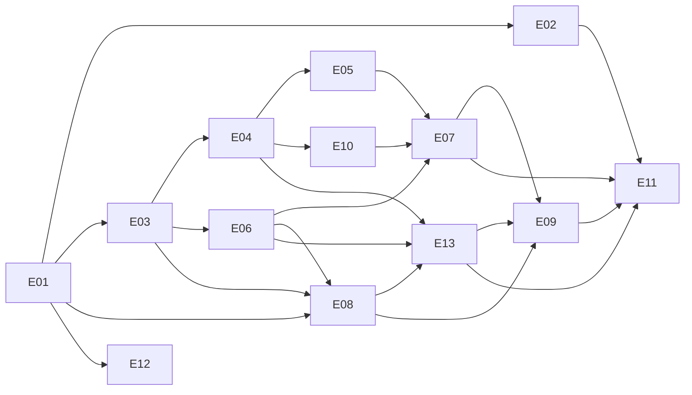

# M0* Backlog: Scaffolding MVP with a Native Tasks Plugin and Themeable Dashboard

| | |
|---|---|
| Milestone | M0* (replaces M0 in spec v0.1) |
| Spec | `docs/spec/hauskraft-spec-v0.4.md` |
| Version | Backlog v0.2, 2026-10-12 |
| Size | 13 epics, 61 stories (all S or M) |

## Goal
Turn the M0 "Skeleton" into a usable MVP. A test user can log in, land on **Today** with a **Tasks** widget, and manage a single shared household to-do list. The list is the **first native plugin** (`dev.hauskraft.tasks`, `runtime.kind: inprocess`), loaded from `hauskraft.plugin.json`, which proves the plugin skeleton end to end. The dashboard is **themeable**: an adult can switch the whole deployment between built-in or installed theme packages that change the look but never the functions.

## In scope
- Monorepo and tooling, CI gates, Docker Compose demo.
- core-api (FastAPI) with local session auth, migrations, the service-layer `authorize()` seam and OpenAPI contract.
- In-process plugin loader, MIT SDKs and schemas.
- Tasks plugin (backend and web): title, done, optional due date. Shared list: any adult may edit or delete any task.
- Web shell with login, navigation, Today widget grid, All tasks page, Activity feed.
- CloudEvents outbox and activity feed.
- **Theming system:** theme contract (DTCG tokens + component styles + limited layout options), `@hauskraft/ui` themed primitives, theme loader/validator/compiler, three built-in themes, deployment-wide theme setting, per-device light/dark/system mode, function-invariance tests, theme authoring kit.
- en/de i18n, ADRs, AGENTS.md, community files.

## Explicitly out of scope
- Third-party integrations of any kind (Vikunja, Donetick, …).
- **Home Assistant connection** (counts as third-party). Only a `HomeAssistantBridge` protocol with a `NullBridge`.
- MCP tool-gateway, agents/LLMs/LiteLLM/Pydantic AI, approvals, Cedar, DBOS.
- Plugin or theme registry and signing; WASM/container/subprocess isolation; runtime install of code plugins; MCP Apps widgets.
- **Theme editor, custom CSS, per-user or per-device themes**, theme hot reload.
- Tenant portal, PWA/offline, kiosk mode.
- OIDC, RBAC enforcement for multiple roles (enum exists, only `adult` enabled).
- Task features beyond title / done / optional due date: no projects, recurrence, assignees, subtasks or labels.

## Milestone acceptance criteria (demo script)
Automated as Playwright `tests/e2e/demo.spec.ts` (already written, red until implemented). The API-level checks behind each step live in `tests/acceptance/api/`; see `docs/testing/README.md`.

1. Given a clean clone with Docker installed, when I run `docker compose up --wait`, then http://localhost:8080 serves the login page within 120 s and `GET /api/v1/readyz` returns 200.
2. When I log in as `demo` / `hauskraft-demo` (a second adult, `alex`, uses the same demo password), then I land on `/today` and see a **Tasks** widget with 3 seeded tasks (1 done, 1 with a due date), in the **Default** theme.
3. When I type "Buy milk" in the widget and press Enter, the task appears at the top without a page reload.
4. When I click the task title in the widget, change it to "Buy oat milk" and press Enter, then set its due date to tomorrow on **All tasks**, the widget shows the new title and a due badge.
5. When I tick its checkbox, it shows as done. When I untick it, it shows as open again.
6. When I open **All tasks** (`/p/tasks`), I see every task with filters Open / Done / All and sort by Created / Due. Deleting a task (with a confirmation) removes it.
7. When I open **Activity** (`/activity`), I see `hauskraft.task.created/updated/completed/deleted` entries with my display name.
8. When I open **Settings → Appearance** and switch the household theme to **Hackspace**, then colours, fonts, card style, icons and navigation style change, and every button, link and label I used in steps 3–7 is still there, in the same order, with the same names. A second browser session, logged in as the second seeded adult `alex`, shows Hackspace within 60 s without a reload.
9. When I set **This device** to Dark, only this browser turns dark. The second browser (left on System, light OS setting) stays light. After a reload, each browser keeps its own mode.
10. When I switch the language to Deutsch, UI strings change and the setting persists after a reload. Theme names are not translated.
11. When I run `docker compose down && docker compose up --wait` and log in again, tasks, the Hackspace theme and the language setting are all still there.
12. CI is green on `main`: lint, typecheck, unit, contract, invariance, e2e, DCO.

## Epics

| ID | Epic | Stories | File |
|---|---|---|---|
| E01 | Repo & tooling | 5 | `E01-repo-and-tooling.md` |
| E02 | CI & quality gates | 5 | `E02-ci-and-quality-gates.md` |
| E03 | Backend core API | 5 | `E03-backend-core-api.md` |
| E04 | Database & migrations | 4 | `E04-database-and-migrations.md` |
| E05 | Auth & users | 5 | `E05-auth-and-users.md` |
| E06 | Plugin skeleton | 6 | `E06-plugin-skeleton.md` |
| E07 | Tasks plugin (backend) | 4 | `E07-tasks-plugin.md` |
| E08 | Web shell & dashboard | 6 | `E08-web-shell-and-dashboard.md` |
| E09 | Tasks UI | 3 | `E09-tasks-ui.md` |
| E10 | Events, activity & governance groundwork | 3 | `E10-events-activity-and-governance-groundwork.md` |
| E11 | Deployment & demo | 3 | `E11-deployment-and-demo.md` |
| E12 | Docs, ADRs & community | 3 | `E12-docs-adrs-and-community.md` |
| E13 | Theming system | 9 | `E13-theming-system.md` |
| | **Total** | **61** | |

Appendices: `A1-agents-md-draft.md` (draft root AGENTS.md), `A2-adr-index.md` (ADRs 0001–0014). Testing: `docs/testing/README.md`, `docs/testing/ui-contract.md`, `docs/testing/traceability.md`.

## Dependency graph



The graph shows epic-level flow. E08 and E13 interleave (E13-02 needs E08-01; E08-06 needs E13-02), so the **story-level `Deps` fields are authoritative**.

## Suggested order and parallelisation (4 agents)
Waves follow the dependency levels computed from the story `Deps` fields (no cycles; critical path is 15 stories deep). Within a wave, start a story only when its own `Deps` are merged.

Agent lanes: **A** backend (E03, E04, E05, E07, E10), **B** web shell and tasks UI (E08, E09), **C** plugins and theming (E06, E13), **D** repo, CI, docs and deploy (E01, E02, E11, E12).

| Wave | A · backend | B · web | C · plugins & theming | D · repo, CI, docs, deploy |
|---|---|---|---|---|
| 0 | — | — | E06-01 | E01-01, E01-02, E01-03, E12-02, E12-03 |
| 1 | E03-01, E03-03, E03-05, E04-01, E10-01 | E08-01, E08-02, E08-04 | E06-02, E13-01, E13-02 | E01-04, E01-05, E02-01, E02-04, E12-01 |
| 2 | E03-02, E03-04, E04-02, E04-03, E04-04, E10-02, E05-01, E05-02, E05-05, E07-01 | — | E06-05, E06-03, E06-06, E06-04, E13-03 | E02-02, E02-05 |
| 3 | E05-03, E05-04, E07-02, E07-03, E07-04, E13-04 | E08-03, E08-05, E08-06 | E13-06, E13-09, E13-05 | E11-02 |
| 4 | E10-03 | E09-01, E09-02, E09-03 | E13-07, E13-08 | E11-01, E11-03, E02-03 |

Lane A picks up E13-04 (theme API) and E10-03 (activity feed) because they are backend-heavy. Lane B is light in wave 2; it can take E13-02 polish or E10-03's web route early against a mock API.

- **Synchronisation points:** `packages/schemas/openapi/core-api.openapi.json` (backend regenerates, frontend consumes) and `packages/schemas/theme/` (token contract that both the compiler and `@hauskraft/ui` depend on). Merge contract PRs first.

## Conventions
- **Story ID:** `M0S-E<epic>-<nn>`, e.g. `M0S-E07-02`. Branch: `m0s/e07-02-tasks-crud`. PR title: `[M0S-E07-02] Tasks CRUD endpoints`.
- **Estimates:** S (≤½ day agent PR, <300 LOC), M (≤1 day, <600 LOC), L (split before Ready).
- **Labels:** `m0-star`, `area:{repo,ci,api,db,auth,plugin,tasks,web,events,deploy,docs,theme}`, `type:{feature,chore,test,docs}`, `agent-ready`, `needs-human`.

## How we work: red, green, refactor
Every story is built test-first.

1. **Red.** Run the story's spec-owned acceptance tests: `python -m pytest tests --story M0S-Exx-yy` (add `--live` with the stack running) and, for UI stories, `HAUSKRAFT_TDD_RAW=1 pnpm --filter @hauskraft/acceptance-e2e exec playwright test --grep @M0S-Exx-yy`. They must fail for the right reason. Then write the unit and integration tests for the code you are about to write, and watch them fail too. Commit: `test(M0S-Exx-yy): red …`.
2. **Green.** Write the least code that makes all of them pass. Commit: `feat(M0S-Exx-yy): …`.
3. **Refactor.** Clean up with every test still green. Commit: `refactor(M0S-Exx-yy): …`.
4. **Flip.** Set the story to `"green"` in `tests/story-status.json` and run `python scripts/backlog_tools.py coverage --write`. From now on its tests are hard gates in CI.

Acceptance tests and fixtures under `tests/` belong to the spec, not to the story. Never weaken, skip or delete one to get to green; if a test looks wrong, stop and raise it in the PR. `in-story` stories (see `docs/testing/traceability.md`) have no pre-written acceptance tests, so their red step starts with writing them.

## Definition of Ready
- The story has an ID, AC in Given/When/Then, files to touch, required tests, dependencies merged (or stubbed), and is estimated S or M.
- Contracts it depends on (OpenAPI, JSON Schema, tables, theme tokens) are merged or specified in the story.
- No open question blocks it, or the question is answered in an ADR.

## Definition of Done
- **Red → green done:** the story's acceptance tests and the tests written first in the story all pass; the story is `green` in `tests/story-status.json`; `docs/testing/traceability.md` is regenerated; no acceptance test or fixture was weakened.
- All AC are covered by automated tests at the stated levels. CI is green, including DCO sign-off.
- Regenerated artefacts are committed (`just gen` leaves a clean `git diff`).
- No new lint suppressions without a comment. mypy strict and `tsc --noEmit` are clean.
- User-facing strings exist in `en` and `de`.
- **UI stories:** only `@hauskraft/ui` primitives and semantic tokens are used (no raw styles); the view renders correctly and passes the invariance check in all three built-in themes, light and dark.
- Docs are updated (README/ADR/AGENTS.md if conventions changed). The CHANGELOG entry is under `Unreleased`.
- No dependency is added without an exact or compatible pin in the lockfile (`uv.lock` / `pnpm-lock.yaml`).

## Handing a story to an AI coding agent (prompt template)

```text
You are implementing story {ID} "{title}" in the Hauskraft monorepo.
Read first: AGENTS.md, docs/backlog/m0-star/README.md, docs/backlog/m0-star/{epic file} (story {ID}),
spec sections: {docs/spec/hauskraft-spec-v0.4.md §…}, ADRs: {list},
contracts: {packages/schemas/... | openapi paths | theme tokens}.
Files you may touch: {paths}. Files you must NOT touch: anything outside these, and lockfiles unless adding a listed dependency.
Acceptance criteria: {paste Given/When/Then}.
Work test-first (README "How we work"): run `python -m pytest tests --story {ID}` (and the tagged Playwright tests) and confirm red;
write the unit/integration tests {unit/contract list} and confirm red; implement until green; refactor; flip the story to green
in tests/story-status.json; run `just check` and `python scripts/backlog_tools.py check` before finishing.
Never edit files under tests/acceptance, tests/e2e or tests/fixtures to make them pass.
Constraints: no new dependencies beyond {list}; plugins import only hauskraft_sdk / @hauskraft/sdk-ts / @hauskraft/ui;
all writes go through a service that calls authorize() and emits an outbox event in the same transaction;
UI uses only @hauskraft/ui primitives and semantic tokens (no colour literals, palette classes or arbitrary values).
Deliver: one PR, conventional commit messages with `Signed-off-by` (git commit -s), PR template filled, regenerated artefacts committed.
If an AC is ambiguous, stop and write the question in the PR description instead of guessing.
```

## Stack pins (October 2026)

| Area | Pin / choice | Note |
|---|---|---|
| Python | 3.13 via `.python-version` | uv 0.13 defaults to 3.15, so pin explicitly |
| API | FastAPI `~=0.143` | OpenAPI 3.1 native |
| ORM | SQLAlchemy `[asyncio]~=2.1.4` + psycopg `~=3.3` | `[asyncio]` extra needed for greenlet |
| Migrations | Alembic `~=1.20` | |
| Validation | Pydantic `>=2.12` + pydantic-settings | |
| DB | `postgres:16-alpine` | UUIDv7 generated in app |
| Password hashing | `pwdlib[argon2]` (argon2id) | ≥ OWASP minimum m=19 MiB, t=2, p=1 |
| CSRF | Synchronizer token + Origin check + SameSite=Lax | |
| Lint/type | ruff `0.17.x`, mypy `2.4.x` strict; `ty` optional, non-blocking | |
| Tests (py) | pytest 9.1, pytest-asyncio 1.4, testcontainers 4.15 | |
| Node | 24 LTS (26 becomes Active LTS on 2026-10-28) | |
| TypeScript | `~6.0` | TS 7 has no stable compiler API until 7.1 |
| Frontend | React 19.3, Vite 8, `@tailwindcss/vite` 4.3, shadcn CLI | shadcn components live in `packages/ui` |
| Routing/data | TanStack Router `1.170.x`, Query `5.104.x` | Lockfile denylist for the May 2026 TanStack compromise (GHSA-g7cv-rxg3-hmpx) |
| Grid | react-grid-layout `^2` | 12 columns, fixed across themes |
| Client codegen | `@hey-api/openapi-ts` exact pin + TanStack Query plugin | Pre-1.0 |
| Web tests | Vitest 4 (+ browser mode), Playwright 1.64 (`toMatchAriaSnapshot` for invariance) | |
| i18n | i18next 26.4, react-i18next 17.0 | |
| Design tokens | DTCG Format 2025.10 (first stable) | Light and dark token files per theme |
| Events | CloudEvents 1.0.2 JSON, extensions `dataclass`, `actorid` | No underscores allowed |
| Agent rules | Root `AGENTS.md` | |
| Acceptance suite | pytest 9.1.1, jsonschema 4.26, httpx 0.28, PyYAML 6.0 (`tests/requirements.txt`); Playwright 1.64.0 + @axe-core/playwright 4.13.0 (`tests/e2e`) | Spec-owned, exists before the code |

Re-check with `uv lock --upgrade` / `pnpm outdated` when implementation starts. Not verified yet: pnpm version, Schemathesis version, Caddy image tag, Compose `include` behaviour of your Docker version.

## M0* repository tree
Only what is created now; `(placeholder)` = README only.

```text
hauskraft/
  AGENTS.md  README.md  LICENSE (AGPL-3.0-or-later)  LICENSING.md  CONTRIBUTING.md  SECURITY.md
  CODE_OF_CONDUCT.md  CHANGELOG.md  justfile  compose.yaml (include: deploy/compose)
  pyproject.toml (uv workspace)  uv.lock  .python-version  package.json  pnpm-workspace.yaml
  pnpm-lock.yaml  .node-version  .pre-commit-config.yaml  REUSE.toml  .editorconfig
  .github/ workflows/{ci.yml,e2e.yml}  ISSUE_TEMPLATE/{bug.yml,feature.yml,story.yml}
           pull_request_template.md  dependabot.yml
  .devcontainer/devcontainer.json            # optional (E01-05)
  apps/web/                                  # React 19 + Vite 8 shell (AGPL)
    index.html (theme <link> + hashed mode script)
    src/{main.tsx,router.tsx,routes/,shell/{nav/,ThemeRuntime.tsx,ColorMode.tsx},dashboard/,
         plugins/registry.gen.ts,i18n/,lib/}
    vite.config.ts  vitest.config.ts
  services/core_api/                         # AGPL
    src/hauskraft_core/{app.py,settings.py,logging.py,errors.py,cli.py,db/,auth/,users/,plugins/,
                       themes/,settings_store/,events/,activity/,policy/,health/,dashboard/,
                       integrations/ha.py,seed/}
    migrations/ (alembic env + core versions)  tests/{unit,integration,contract}  Dockerfile
  services/{gateway,agents,workflows,plugin_host}/README.md   (placeholder)
  packages/sdk-py/  src/hauskraft_sdk/ (MIT)
  packages/sdk-ts/  src/ (MIT; generated client in src/client)
  packages/ui/      src/{components/,icons/,tokens/,widget/} (MIT; @hauskraft/ui)
  packages/schemas/ (MIT) manifest/hauskraft.plugin.schema.json  theme/{hauskraft.theme.schema.json,
                    tokens-v1.json,icon-names-v1.json}  events/cloudevent.schema.json
                    events/{task.*,settings.theme_changed}.data.schema.json  openapi/core-api.openapi.json
  plugins/official/tasks/  hauskraft.plugin.json  LICENSE (MIT)
    backend/src/hauskraft_tasks/{plugin.py,models.py,schemas.py,service.py,router.py,events.py}
    backend/migrations/versions/  backend/tests/
    web/src/{widgets/TasksWidget.tsx,pages/TasksPage.tsx,components/,locales/{en,de}/tasks.json}
  themes/builtin/{default,paper,hackspace}/   hauskraft.plugin.json theme.json tokens.{light,dark}.json assets/ LICENSES/
  themes/template/                           # authoring starting point
  integrations/ha-hauskraft/README.md          (placeholder)
  deploy/compose/{compose.yaml,compose.test.yaml,Caddyfile,.env.example}   deploy/ha-addon/README.md (placeholder)
  docs/spec/hauskraft-spec-v0.4.md  docs/adr/0001-…md … 0013-…md  docs/backlog/m0-star/*.md
  docs/how-to-test.md  docs/themes.md
  fixtures/household/demo.json
  tests/                                     # spec-owned acceptance suite (MIT), committed before the code
    conftest.py  story-status.json  requirements.txt  _support/  meta/
    acceptance/{repo,schemas,themes,web,api}/  fixtures/  e2e/{demo,tasks,theme-invariance}.spec.ts
  docs/testing/{README.md,ui-contract.md,traceability.md}
  scripts/                                   # backlog_tools.py, export_openapi.py, gen-plugin-registry.mjs, gen-theme-types.*, check-*.{py,mjs}, subset-fonts.py
  tools/eslint-plugin-hauskraft/              # no-raw-styles rule (MIT)
  data/themes/README.txt                     # compose volume for installed themes (gitignored except README)
```

## Decisions since backlog v0.1

| ID | Decision |
|---|---|
| D1 | CloudEvents extension attributes are `dataclass` and `actorid`. JSON bodies and DB columns keep `data_class`. |
| D2 | Licences: core AGPL-3.0-or-later. SDKs, schemas, `@hauskraft/ui`, official plugins and built-in themes MIT. Bundled fonts OFL-1.1. MPL-2.0 dropped. |
| D3 | Shared list: any adult may edit or delete any task. |
| D4 | Theming: tokens + component styles/icons + limited layout (navigation style, density, content width). No custom CSS. Themes come as packages; no editor; three built-in themes. |
| D5 | One theme per deployment, for everyone on every device. Colour mode (system/light/dark) is per device. |
| D6 | Themes never move, hide, rename or reorder functions (enforced by ARIA invariance tests and contrast rules). |
| D7 | HearthOS stays the working name; rename before public release (clash with the commercial Hearth family display). Superseded: renamed to Hauskraft (ADR 0015). |
| D8 | Home Assistant is treated as third-party in M0*: `NullBridge` only. |
| D9 | Built-in themes are Default, Paper and Hackspace (underground hackerspace style, inspired by the Berlin scene, no third-party names or logos). |
| D10 | Red/green TDD. A spec-owned acceptance suite (`tests/`) exists before the code; `tests/story-status.json` flips each story from red to green as its last Definition-of-Done step. |

## Risks and open questions (M0*)
- **Build-time web plugins:** code plugins can't be installed at runtime in M0*. Themes can (data only, picked up at API restart).
- **Plugin isolation:** the in-process loader means a bad plugin can crash core. Acceptable only for first-party code.
- **Alembic branches:** multi-branch migrations (`heads`) add complexity; plugin migrations may only depend on core heads.
- **Fast-moving pins:** FastAPI ships several releases a month, SQLAlchemy 2.1 is fresh, Ruff minor bumps change default rules. Rely on lockfiles and Dependabot grouping.
- **Cookies:** `Secure` is off in the HTTP-only local demo. Document a TLS-fronted deployment before any LAN exposure.
- **Theme invariance test brittleness:** ARIA snapshots can fail on legitimate copy changes. Snapshots are compared across themes in the same run, not against stored baselines, so only theme-induced differences fail.
- **Theme compiler correctness:** colour parsing and contrast maths must handle OKLCH and P3 values; use a tested library and golden tests.
- **Theme propagation delay:** up to 60 s on other devices (polling). Live push arrives with the event bus later.

## What M1 picks up next
- MCP tool-gateway behind `authorize()`, with Cedar policies and hash-chained audit fed from `outbox_events`.
- ha-bridge and `integrations/ha-hauskraft` replace `NullBridge`; OIDC `IdentityProvider`; RBAC for owner/adult/teen/kid (theme switching becomes owner-only).
- First external connector plugin (e.g. Vikunja or Donetick), following "tool of record wins" against the native list, starting the plugin_host subprocess runtime.
- Outbox consumers (DBOS workflows) and `subscribes[]` delivery; live theme push.
