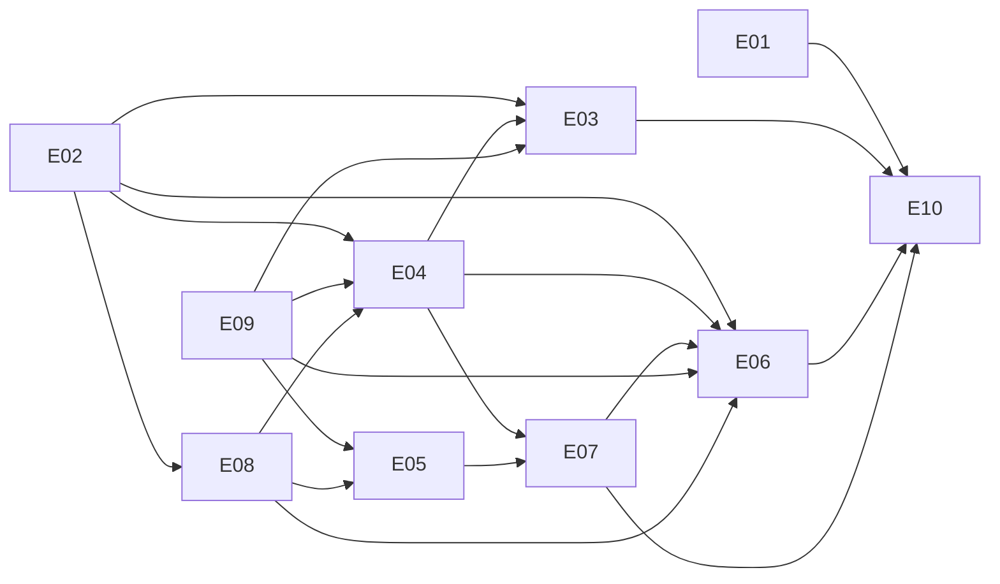

# M1* Backlog: Household Basics

| | |
|---|---|
| Milestone | M1* (replaces the spec v0.2 M1 as the next milestone; spec C8, D11) |
| Spec | `docs/spec/hauskraft-spec-v0.3.md` (§2.3 is the heart of this milestone) |
| Version | Backlog v0.1, 2026-10-22 (draft for review) |
| Size | 10 epics, 35 stories (all S or M) |

## Goal
Make Hauskraft usable by a real household, not only by the demo users. A parent installs it without demo data,
opens it in the browser, names the household and creates the first account (the **owner**). The owner adds the
partner as an **adult**; everyone manages their own name, language, password and signed-in devices; the owner can
reset a forgotten password or deactivate an account. Owners run the household settings (name, time zone, default
language) and the theme. Every change to who can act in the household shows in Activity.

## In scope
- Roles `owner` and `adult`, enforced by a static permission table behind `authorize()` (ADR 0016).
- First-run setup wizard; the first visitor becomes owner (ADR 0017). Web port bound to localhost by default.
- My account: display name, language, password change, sessions per device, sign out everywhere.
- Members (owners): list, add with a temporary password, edit name and role, deactivate, reactivate, reset password,
  at least one active owner at all times. CLI parity for recovery.
- Forced password change after a new account or a reset; clear "session ended" and "account deactivated" messages;
  password rules up front; correct `autocomplete`.
- Household settings: name (browser title), time zone (what "today" means for due dates), default language.
- Settings area with sections Appearance, Account, Household, Members (role-aware, theme-invariant).
- Account CloudEvents and their Activity summaries in en and de (ADR 0018).
- A second, unseeded "fresh" stack for first-run tests, locally and in CI.

## Explicitly out of scope
- Cedar or any policy engine beyond the static table; approval inbox; audit hash chain; verify hooks.
- MCP gateway, agent skills, agents, LLM routing (how plugins reach agents is an open question, spec §14).
- Home Assistant (bridge, integration, entities); OIDC/SSO; MFA; email (no password-reset mail).
- Roles other than `owner` and `adult` (teen, kid, caregiver, …) and their views.
- Deleting accounts (deactivation only); per-user themes; avatars.
- Backup and restore, published release images, phone-optimised layout, new task features. These are tracked in
  the Linear project "Hauskraft Backlog" with the other open topics.

## Milestone acceptance criteria (demo script)
Automated as Playwright `tests/e2e/basics.spec.ts` against the **fresh stack** (no demo seed, port 8081, see E01).
The API-level checks behind each step live in `tests/acceptance/api/`. The M0* demo (`tests/e2e/demo.spec.ts`) must
keep passing on the demo stack.

1. Given a clean fresh stack (`HAUSKRAFT_SEED_DEMO=false`), when I open the app, then I see the setup wizard
   ("Set up your household"), not the login page, and it passes axe.
2. When I set up household "Familie Müller" in Deutsch with time zone Europe/Berlin and the account "Mia" (`mia`),
   then I land on `/today`, signed in, with German labels ("Heute") and the browser title "Heute · Familie Müller".
   Opening `/setup` again redirects away, and `POST /api/v1/setup` answers 409 `setup_done`. Mia then switches her
   own language to English in the account menu.
3. When Mia opens Settings (sections Appearance, Account, Household, Members) → Members and adds "Alex" (`alex`) as an
   adult with a temporary password, then Alex is listed, and Activity shows "Mia added Alex to the household".
4. When Alex signs in with the temporary password in a second browser, then Alex must choose a new password first, on
   a page in German (new members start in the household language), and then lands on Today. Alex switches to
   English and adds the task "Plan the garden".
5. Alex's Settings show the sections Appearance and Account only. The household theme is shown but cannot be changed
   ("Only owners can change the household theme."), while the device colour mode still works. `GET /api/v1/users` as
   Alex answers 403 `policy_denied`.
6. When Alex changes the display name to "Alex M." and the password, then the changes stick after a reload. With a
   third browser signed in as Alex, Account → Devices lists two devices; signing out the other one ends that session.
7. When Mia resets Alex's password, then Alex's session ends ("Your session has ended. Please sign in again.") and
   Alex must choose a new password after signing in with the new temporary one.
8. When Mia deactivates Alex, then Alex's session ends at the next request, and signing in shows "This account is
   deactivated. Ask an owner of your household." Activity still shows "Alex M. added 'Plan the garden'". After Mia
   reactivates Alex, Alex can sign in again.
9. When Mia tries to deactivate herself or make herself an adult while she is the only owner, then she sees "The
   household needs at least one active owner." and stays an owner.
10. When Mia changes the household name to "Familie Müller-Schmidt" and the time zone to Pacific/Kiritimati, then the
    browser title follows, and a task due today in Kiritimati shows "Today" while one due the day before shows
    "Overdue".
11. When a session ends while the app is open (here: Mia signs out everywhere from another browser), then the next
    action (adding a task on Today) shows "Your session has ended. Please sign in again." and signing in returns to
    `/today`.
12. All new settings views pass the function-invariance and axe checks in the three built-in themes, light and dark,
    as owner and as adult (`tests/e2e/settings.spec.ts`); CI is green on `main`, including the fresh-stack suites and
    the M0* demo.

## Epics

| ID | Epic | Stories | File |
|---|---|---|---|
| E01 | Fresh stack & CI | 2 | `E01-fresh-stack-and-ci.md` |
| E02 | Roles & permissions | 4 | `E02-roles-and-permissions.md` |
| E03 | First-run setup | 4 | `E03-first-run-setup.md` |
| E04 | Household settings | 4 | `E04-household-settings.md` |
| E05 | My account | 4 | `E05-my-account.md` |
| E06 | Members | 6 | `E06-members.md` |
| E07 | Sign-in | 4 | `E07-sign-in.md` |
| E08 | Settings shell | 3 | `E08-settings-shell.md` |
| E09 | Account events & activity | 2 | `E09-account-events-and-activity.md` |
| E10 | Docs & demo | 2 | `E10-docs-and-demo.md` |
| | **Total** | **35** | |

## Dependency graph

The story-level `Deps` fields are authoritative. Every write story depends on M1S-E09-01 (event schemas) because it
emits its event in the same story (AGENTS.md rule 1).

## Suggested order and parallelisation (3 lanes)
Waves are the dependency levels computed from the story `Deps` fields; start a story only when its own `Deps` are
merged.

| Wave | A · backend | B · web | C · deploy, CI, docs |
|---|---|---|---|
| 0 | E02-01, E05-02, E09-01 | E07-03 | E01-01, E03-04 |
| 1 | E02-02, E02-04, E04-01, E05-01 | E09-02 | E01-02 |
| 2 | E02-03, E03-01, E06-01, E07-01 | E04-03, E04-04, E08-01 | E03-03 |
| 3 | E06-02, E06-04 | E03-02, E04-02, E05-03, E07-02, E08-02, E08-03 | — |
| 4 | E06-03 | E05-04 | — |
| 5 | E06-06 | E06-05, E07-04 | — |
| 6 | — | — | E10-01, E10-02 |

- **Synchronisation points:** `packages/schemas/openapi/core-api.openapi.json` (backend regenerates, web consumes),
  `packages/schemas/events/` (E09-01 first), and the permission vocabulary in E02-01.

## Conventions
Same as M0* (`docs/backlog/m0-star/README.md`), with the M1* prefix:
- **Story ID:** `M1S-E<epic>-<nn>`, e.g. `M1S-E06-03`. Branch: `m1s/e06-03-deactivate-members`. PR title:
  `[M1S-E06-03] Deactivate and reactivate members`.
- **Estimates:** S (≤½ day agent PR, <300 LOC), M (≤1 day, <600 LOC), L (split before Ready).
- **Labels:** `m1-star`, `area:{repo,ci,api,db,auth,web,events,deploy,docs,theme,tasks}`,
  `type:{feature,chore,test,docs}`, `agent-ready`, `needs-human`.
- **Linear:** project "Hauskraft M1*", one milestone per epic, one issue per story with blocked-by relations.

## How we work: red, green, refactor
Exactly as in M0* and `AGENTS.md`: run the story's spec-owned tests in raw mode and watch them fail for the right
reason (`python -m pytest tests --story M1S-Exx-yy`, with `--live` against the demo stack and, for first-run tests,
the fresh stack; `HAUSKRAFT_TDD_RAW=1 pnpm --filter @hauskraft/acceptance-e2e exec playwright test --grep @M1S-Exx-yy`),
write the unit and integration tests, go green, refactor, flip the story in `tests/story-status.json`, regenerate
`docs/testing/traceability.md`. Never weaken a spec-owned test.

**Fresh stack.** Tests marked `fresh` (pytest) and `tests/e2e/basics.spec.ts` need an unseeded stack at
`HAUSKRAFT_FRESH_BASE_URL` (default `http://localhost:8081`). They reset it before they start by running
`HAUSKRAFT_FRESH_RESET_CMD` when it is set. Without `HAUSKRAFT_FRESH_BASE_URL` they are skipped, and CI always sets
it (M1S-E01-02).

**Shared demo stack.** API and e2e tests on the demo stack never change `demo`'s or `alex`'s password, role or
status. They create throwaway members (usernames `acc…` or `e2e…`) and deactivate them afterwards. Tests that change
household settings restore them.

## Definition of Ready and Done
As in M0* (`docs/backlog/m0-star/README.md`), plus:
- **Permissions:** every new write path has an action in the E02-01 table and a denial test for the role that may
  not use it.
- **Secrets:** no password, hash, session ID or IP address in events, logs, API responses (except the session list's
  own device description) or the UI.
- **Both roles:** UI stories are checked as owner and as adult.

## Handing a story to an AI coding agent (prompt template)
Use the M0* template with these paths: `docs/backlog/m1-star/README.md`, the epic file, `docs/spec/hauskraft-spec-v0.3.md`
§2.3 plus the sections the story cites, ADRs 0006, 0007, 0016–0018, and `docs/testing/ui-contract.md` for UI stories.

## Decisions for this backlog

| ID | Decision |
|---|---|
| D1 | Roles `owner` and `adult`; static permission table; denials are 403 `policy_denied` (ADR 0016). |
| D2 | First run: the first visitor wins; no setup code (ADR 0017). |
| D3 | Account events in Activity; language changes and session bookkeeping emit none (ADR 0018). |
| D4 | `/settings` keeps landing on Appearance (M0* contract); sections are ordered Appearance, Account, Household, Members. |
| D5 | Accounts are deactivated, never deleted, in M1*. Usernames are fixed after creation. |
| D6 | The household time zone, not the browser's, decides "today" for due badges. |
| D7 | Two M0* acceptance assertions are superseded by M1* behaviour and were moved, not weakened: the seeded `demo` is now `owner` (M1S-E02-03), and `owner` is creatable (M1S-E02-02). The M0* tests now check only what still holds. |

## Risks and open questions
- **First visitor wins** on an exposed port (spec §14 item 15). Localhost binding by default (M1S-E03-04) and docs.
- **Fresh-stack resets in CI** add a few minutes to the e2e job. If that hurts, merge the pytest and Playwright
  fresh runs behind one reset.
- **Forced password change gate** must not lock out the web shell. The allowlist is part of M1S-E07-01's contract.
- **Time zone list:** the browser's `Intl.supportedValuesOf("timeZone")` and the server's IANA database (Python
  `zoneinfo`) can differ slightly. The API validates against the server's list.
