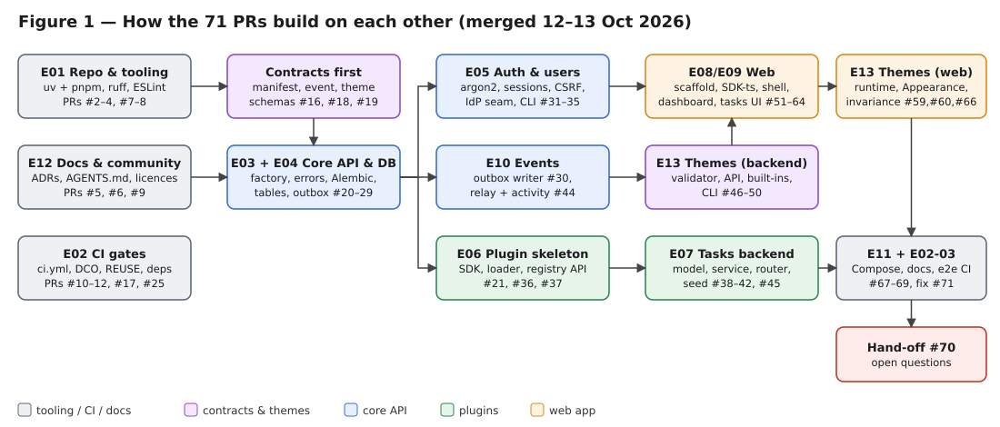
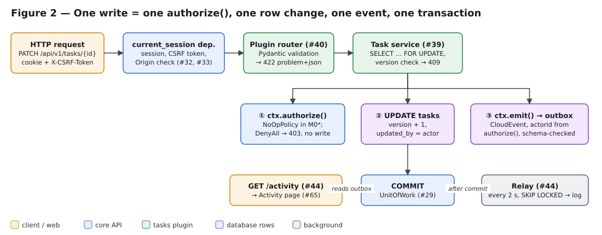
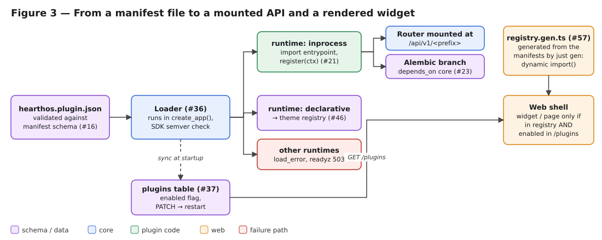
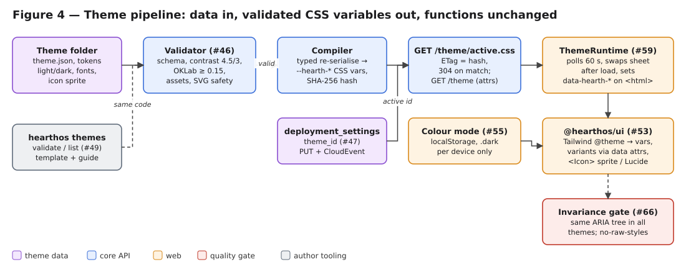
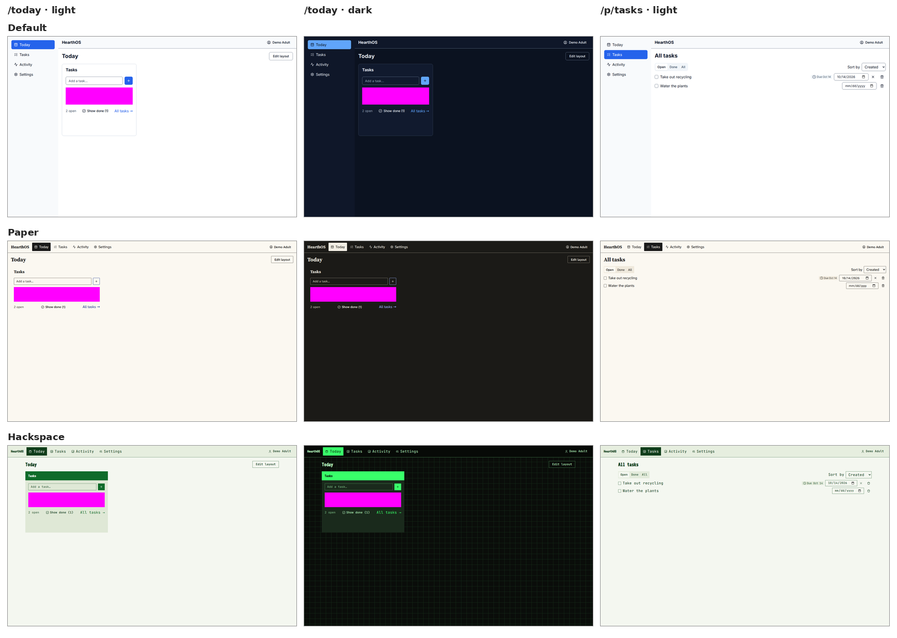

# HearthOS M0* — PR by PR

*A tutor's brief on all 71 pull requests of the first milestone (M0\*), merged 12–13 October 2026.*

## How to read this brief

Every PR gets the same four parts:

1. **Summary**: what the PR does and why it was needed.
2. **Technical details**: how it works, in a few bullets.
3. **Judgment**: how good the implementation is, and what to watch.
4. **Alternatives**: other viable designs, each with a short pro and con.

**Word limit.** A story PR's explainer is capped at about **180 words**. Housekeeping PRs (closed Dependabot
bumps, status flips, docs) get about **80 words**. That keeps the brief at around 11,000 words, so you can read
it in an hour or look up a single PR in a minute.

Each heading shows the PR number, the backlog story ID (`M0S-Exx-yy`) and the title. The line under it gives the
merge date, the lines added and removed, and the number of files changed. Lockfiles and generated files make some
PRs look bigger than they are.

## The milestone in one page

**Goal of M0\*.** A test household can log in, land on a **Today** dashboard with a **Tasks** widget, share one
to-do list between adults, follow an **Activity** feed, and switch the whole deployment between three
**themes** that change the look but never the functions. Tasks is built as the first **plugin**, which
proves that the plugin system works end to end. Everything runs with `docker compose up`.

**How it was built.** One AI agent worked through 61 backlog stories in 13 epics over about 23 hours. It opened
one PR per story and kept a strict **red → green → refactor** commit order. Before any code existed, the spec
owner had already written acceptance tests under `tests/acceptance` and `tests/e2e`. These are "spec-owned": the
implementer may not edit them. A story counts as done ("flipped" to green in `tests/story-status.json`) only when
its spec-owned tests pass. Several PRs therefore say "implemented, not flipped": the code was merged, but the
story's tests also needed a later story.

**Core rules that shape almost every PR** (from `AGENTS.md`):

- Every write goes through a **service** that calls `authorize()` first and emits **exactly one CloudEvent** in the
  same database transaction (Figure 2).
- Plugins import only the SDKs, never core code. A lint rule enforces this.
- The API contract is a **generated** OpenAPI 3.1 file, and the TypeScript client is generated from it.
- **Themes are data only.** A theme may change how things look, but it may never change what the app does. The
  test for this is that the accessibility tree is identical in every theme.

**The result.** These screenshots are the visual test baselines from PR #71. They show the same two views in all
three themes. The magenta blocks are masks the test applies to dynamic task rows.

---

# Part A — Repository, tooling and governance

### #1 · ci: restore acceptance bootstrap workflow
*Merged 12 Oct 21:42 UTC · +27 / −0 lines · 1 files*

1. **Summary.** This PR re-adds the first CI gate. The workflow file had been left out of the initial push
   because the token then had no permission to push workflow files.
2. **Technical details.** `acceptance.yml` runs `backlog_tools.py check` (spec, backlog, status and coverage are
   consistent) and `pytest tests --strict-status`. Stories that are not built yet report as xfail.
3. **Judgment.** This was the right first move: it gives a gate before any code exists. It was meant to be
   temporary and was folded into `ci.yml` by #10.
4. **Alternatives.** *Start straight with the full `ci.yml`*: one less file to churn, but no gate during the
   first stories.

### #2 · [M0S-E01-01] Monorepo skeleton and workspaces
*Merged 12 Oct 21:53 UTC · +911 / −2 lines · 37 files*

1. **Summary.** This PR creates the empty shape of the whole project, with one repository holding the Python
   backend, the SDKs, the plugin and the web packages. Every later PR fills in a part of this skeleton.
2. **Technical details.**
   - A virtual **uv workspace** (Python 3.13) holds three members: `hearthos_core` (AGPL), `hearthos_sdk` and
     `hearthos_tasks` (MIT).
   - A **pnpm workspace** (Node 24) holds the four TS packages. TypeScript is pinned to `~6.0` (ADR-0011).
   - `compose.yaml` has only the `db` service for now. Placeholder READMEs mark the services planned for later
     milestones.
   - The acceptance-suite pins are *mirrored* into the dev group, so `tests/requirements.txt` stays as it is.
3. **Judgment.** A clean skeleton that splits the licences along folder lines. The mirrored pins are a
   pragmatic answer to a contradiction in the story, but the same versions now live in two places.
4. **Alternatives.**
   - *Separate repositories per licence*: a cleaner licence story, but cross-cutting changes become painful.
   - *Poetry or Nx/Turborepo instead of uv/pnpm*: richer task graphs, but slower and with more configuration.

### #3 · [M0S-E01-02] Python tooling config
*Merged 12 Oct 21:57 UTC · +507 / −8 lines · 6 files*

1. **Summary.** This PR sets the Python quality bar (ruff, mypy `--strict`, pytest markers) and turns the
   architecture rule "plugins never import core" into a lint error.
2. **Technical details.**
   - Ruff's `banned-api` bans `hearthos_core`. A per-file ignore `"!plugins/**"` applies the ban only to plugin
     code.
   - mypy runs strict with the Pydantic plugin. pytest has the markers `unit`, `integration` and `contract`.
   - The spec-owned test folders are excluded from ruff, because they have 91 findings and may not be edited.
3. **Judgment.** Enforcing an architecture boundary with a linter is cheap and effective. The exclusion is
   honest and documented, though it leaves part of the code base unlinted.
4. **Alternatives.**
   - *import-linter contracts*: richer layer rules, but one more tool.
   - *A separate, looser ruff profile for the spec tests*: keeps some linting there, but adds config noise.

### #4 · [M0S-E01-03] TypeScript tooling config
*Merged 12 Oct 22:05 UTC · +2,611 / −64 lines · 20 files*

1. **Summary.** This PR does for TypeScript what #3 did for Python: a shared strict `tsconfig`, ESLint 9,
   Prettier, and an import allowlist for plugin web code.
2. **Technical details.**
   - `no-restricted-imports` regex patterns allow only `@hearthos/sdk-ts`, `@hearthos/ui`, React, i18next and
     TanStack Query inside `plugins/**/web`. Gitignore-style negation patterns could not express this.
   - ESLint stays on 9 because `jsx-a11y` does not support 10 yet.
   - typescript-eslint was taken one patch older than the latest, because pnpm's `minimumReleaseAge` refuses
     releases younger than one day.
3. **Judgment.** Solid. Respecting the release-age guard instead of overriding it shows good supply-chain
   discipline.
4. **Alternatives.**
   - *eslint-plugin-boundaries*: expresses the allowlist by layer, but adds another plugin.
   - *Biome*: a single fast tool, but it lacks jsx-a11y parity.

### #5 · [M0S-E12-02] ADRs 0001–0014
*Merged 12 Oct 22:09 UTC · +619 / −2 lines · 17 files*

1. **Summary.** This PR records the 14 founding architecture decisions as ADRs: the stack split, the licence
   split, the in-process plugins, local auth, the `authorize()` seam, the CloudEvents outbox, UUIDv7, client
   generation, the TS 6.0 pin, the widget grid, theming and TDD.
2. **Technical details.** The ADRs use MADR 4 format with YAML front matter, plus an index and a template.
   ADR-0013 fixes the theme thresholds: text contrast ≥ 4.5:1, non-text ≥ 3:1, an OKLab distance of at least
   0.15 between destructive and primary, and size limits for assets.
3. **Judgment.** Writing the ADRs first gives every later PR something to cite. They are condensed from the
   spec rather than argued afresh, which is fine for a bootstrap but makes them thin on rejected options.
4. **Alternatives.** *Keep the decisions inside the spec*: one less place to maintain, but the decisions are
   harder to supersede one at a time.

### #6 · [M0S-E12-03] Licences and community files
*Merged 12 Oct 22:15 UTC · +909 / −6 lines · 32 files*

1. **Summary.** This PR makes the dual licence model real. Core is AGPL; SDKs, plugins and themes are MIT, so
   third parties can build on them. It also adds the community files and a `HomeAssistantBridge` stub.
2. **Technical details.**
   - MIT `LICENSE` files go in each MIT package. `REUSE.toml` and SPDX headers make `reuse lint` pass.
   - The PR adds `CONTRIBUTING`, `SECURITY`, the Contributor Covenant 3.0, issue forms and a PR template.
   - `NullBridge` implements the Home Assistant protocol without doing anything (HA itself is out of scope).
   - It starts `docs/handoff/m0-star-open-questions.md`.
3. **Judgment.** Thorough. Two items need an admin: private vulnerability reporting must be switched on, and
   `SECURITY.md` points to it.
4. **Alternatives.**
   - *A single licence (e.g. Apache-2.0)*: simpler, but it gives up AGPL's protection of the core.
   - *A CLA instead of the DCO*: allows relicensing later, but puts off contributors.

### #7 · [M0S-E01-04] justfile and pre-commit
*Merged 12 Oct 22:23 UTC · +188 / −9 lines · 7 files*

1. **Summary.** This PR gives humans and CI one command vocabulary: `just setup`, `dev`, `check`, `gen`,
   `acceptance` and so on. It also adds pre-commit hooks.
2. **Technical details.**
   - `just dev` starts the DB, uvicorn and Vite together.
   - Generator recipes that don't exist yet print "not implemented yet", so `just gen` already works.
   - Hook repos are pinned to tags. `check-yaml` allows multi-document YAML (pnpm 12 lockfiles).
   - `REUSE.toml` now makes AGPL the default for every path.
3. **Judgment.** Good. The stub recipes keep CI wiring stable. The risk is that a drift check can pass while it
   checks nothing yet.
4. **Alternatives.**
   - *Makefile*: available everywhere, but has awkward syntax and tab pitfalls.
   - *npm scripts only*: no extra tool, but Python tasks fit poorly.

### #8 · [M0S-E01-05] Devcontainer (optional)
*Merged 12 Oct 22:26 UTC · +35 / −2 lines · 3 files*

1. **Summary.** This PR adds an optional VS Code / Codespaces dev environment.
2. **Technical details.** It uses the Python 3.13 image with the Node 24, Docker-in-Docker, uv and just
   features. `postCreateCommand` runs `just setup`, and the ports for the API, Vite and the demo are forwarded.
3. **Judgment.** The PR openly says it is **not verified**, because no VS Code was available. That honesty
   matters: the acceptance criterion is still unticked.
4. **Alternatives.** *Nix flake*: reproducible to the byte, but a steep learning curve for contributors.

### #9 · [M0S-E12-01] AGENTS.md
*Merged 12 Oct 22:29 UTC · +63 / −3 lines · 7 files*

1. **Summary.** This PR finalises the rulebook for AI agents and humans. The root file links the spec, the ADRs,
   the backlog and the testing guide. Nested files add rules for single folders.
2. **Technical details.** It adds nested `AGENTS.md` files in `apps/web`, `packages/ui`, the tasks plugin and
   `themes`. They restate only local rules (import limits, generated files, migrations) and link to the rest
   instead of copying it.
3. **Judgment.** Short, linked and not duplicated: exactly how an agent rulebook should be. One mismatch with
   `ui-contract.md` turned up later (#53).
4. **Alternatives.** *One long root file*: everything in one place, but agents load more irrelevant context.

### #10 · [M0S-E02-01] CI workflow: lint + typecheck + unit
*Merged 12 Oct 22:33 UTC · +153 / −37 lines · 7 files*

1. **Summary.** This PR builds the real CI: parallel jobs for lint, typecheck, Python and web unit tests, the
   acceptance suite and an offline link check.
2. **Technical details.**
   - A composite action `.github/actions/setup` caches uv and pnpm.
   - Each job has an 8-minute timeout.
   - `testpaths` makes `pytest -m unit` collect only package tests. The spec suite runs with an explicit
     `pytest tests`.
   - The bootstrap `acceptance.yml` from #1 is deleted.
3. **Judgment.** Well structured, but **branch protection is not set**, because the token has no admin rights.
   So the gates are advisory: a red check does not block a merge. This is the biggest open governance gap of
   the milestone.
4. **Alternatives.**
   - *One serial job*: simpler to read, but slower, and a failure is less specific.
   - *A merge queue*: guarantees green `main`, but needs admin setup.

### #11 · [M0S-E02-04] DCO, REUSE and licence checks
*Merged 12 Oct 22:39 UTC · +322 / −2 lines · 5 files*

1. **Summary.** This PR enforces the licence rules automatically. Every commit must be signed off (DCO), every
   file must have a licence (REUSE), and each folder must carry the *right* licence.
2. **Technical details.**
   - A `dco` job runs on PRs and prints the fix command when it fails.
   - `scripts/check-licence-map.py` (175 lines) reimplements REUSE's precedence rules (closest, aggregate,
     override) to check AGPL vs MIT vs OFL per path.
   - The dependency licence report runs with `continue-on-error`, as the M0\* story allows.
3. **Judgment.** Effective, but the custom script re-implements REUSE logic and could drift from REUSE itself.
4. **Alternatives.**
   - *Parse `reuse spdx` output*: one source of truth, but a slower and clunkier parse.
   - *DCO GitHub App*: zero code, but it needs org admin to install.

### #12 · [M0S-E02-05] Dependency hygiene
*Merged 12 Oct 22:43 UTC · +173 / −2 lines · 6 files*

1. **Summary.** This PR adds supply-chain guards: weekly grouped Dependabot PRs, `pnpm audit`, a `uv lock` check
   and a denylist of known-compromised versions.
2. **Technical details.** It covers uv, npm, Actions, docker and docker-compose. `scripts/check-denylist.mjs`
   scans the lockfile. `pnpm audit` fails on high severity and above.
3. **Judgment.** A good baseline. The denylist holds only the 4 versions the story names, while the advisory
   (GHSA-g7cv-rxg3-hmpx) lists 84 versions across 42 packages. That gap is noted in the hand-off.
4. **Alternatives.**
   - *Renovate*: finer grouping and auto-merge rules, but more configuration.
   - *OSV-Scanner*: an advisory-driven, complete list, but one more dependency.

### #13 · Dependabot: postgres 16 → 18 (closed)
*Closed unmerged · +1 / −1 lines · 1 files*

**Summary and judgment.** This was the first automated PR from #12, and it would have broken the pinned
database major. It was correctly **closed**, with a pointer to #17. Upgrading Postgres needs a deliberate
`pg_upgrade` plan, not a bot PR. *Alternative:* accept it and test against 18. That would be fine for a fresh
project, but it breaks the spec's stack table.

### #14 · Dependabot: ESLint 9 → 10, @types/node 24 → 26 (closed)
*Closed unmerged · +196 / −232 lines · 3 files*

**Summary and judgment.** It was closed for the same reason. `eslint-plugin-jsx-a11y` does not support ESLint 10
yet, and the Node types must match the Node 24 runtime. *Alternative:* split the group so that safe bumps go
through while ESLint waits. That is more granular, but means more PRs.

### #15 · Dependabot: TypeScript 6.0 → 7.0 (closed)
*Closed unmerged · +254 / −53 lines · 4 files*

**Summary and judgment.** It was closed. ADR-0011 pins TS `~6.0` until 7.x (the Go-based compiler) has a stable
compiler API, and typescript-eslint supports only `<6.1`. This is a sensible decision, recorded in an ADR rather
than a comment.

### #17 · chore(deps): Dependabot respects pinned major versions
*Merged 12 Oct 22:54 UTC · +18 / −0 lines · 1 files*

1. **Summary.** This is the follow-up to #13–#15. Dependabot now proposes only minor and patch updates, and major
   upgrades become a deliberate, reviewed change.
2. **Technical details.** `ignore: update-types: semver-major` covers every ecosystem, plus TypeScript `>=6.1`.
3. **Judgment.** The right policy for a young project with pinned majors. The risk is silence: security fixes
   that ship only in a new major won't show up. Pair it with `pnpm audit` / `uv` audit alerts (#12 partly does
   this).
4. **Alternatives.** *Keep the major PRs open but labelled "blocked"*: they stay visible, but they are noise.

---

# Part B — Contracts and schemas

### #16 · [M0S-E06-01] Manifest and event JSON Schemas
*Merged 12 Oct 22:52 UTC · +1,893 / −3 lines · 31 files*

1. **Summary.** This PR defines the **plugin manifest** (`hearthos.plugin.json`) as a JSON Schema. Every plugin and
   theme describes itself with one, so this schema is the gate for the whole plugin system.
2. **Technical details.**
   - The schema uses JSON Schema 2020-12, with shared definitions in `common/defs.schema.json`: the data-class
     enum, icon names, the capability pattern and SemVer.
   - An `if/then` rule makes themes declarative-only: no capabilities, no widgets, and at least one theme entry.
   - Unknown keys and widget sizes beyond 12 columns are rejected.
   - It has 4 valid and 19 invalid fixtures.
3. **Judgment.** A strong contract with good negative tests. A test tagged with two stories reports "BROKEN"
   until the second story lands. That is a quirk of the test harness, not a bug.
4. **Alternatives.**
   - *Define it as a Pydantic model and export the schema*: one source in Python, but less control over the
     2020-12 features and harder for TS tools to own.
   - *TOML manifest*: friendlier to read, but has no schema standard.

### #18 · [M0S-E10-01] Event schemas
*Merged 12 Oct 22:58 UTC · +454 / −4 lines · 16 files*

1. **Summary.** This PR defines the **CloudEvent envelope** and the data schemas for the task, plugin and theme
   events, plus matching Pydantic models in the SDK.
2. **Technical details.**
   - The envelope requires `specversion, id, source, type, dataclass`. Attribute names allow only lower-case
     letters and digits, so `data_class` is rejected, as the CloudEvents spec demands.
   - `DataClass` is an ordered enum, so `max()` of the inputs gives the most sensitive class ("taint").
   - Tests run both ways: fixtures parse into the models, and dumped models validate against the schemas.
3. **Judgment.** Careful and spec-faithful. Two schema URL domains (`hearthos.dev` and `schemas.hearthos.org`)
   remain to be unified.
4. **Alternatives.**
   - *AsyncAPI document*: describes channels too, but is heavier than M0\* needs.
   - *Protobuf events*: compact and typed, but a poor fit for JSON-first web tooling.

### #19 · [M0S-E13-01] Theme contract schemas
*Merged 12 Oct 23:06 UTC · +2,443 / −5 lines · 33 files*

1. **Summary.** This PR defines exactly what a theme may contain: design tokens (in the DTCG format), component
   variants, layout options, fonts and icons. It is the legal boundary that makes "themes are data, not code"
   enforceable.
2. **Technical details.**
   - Every schema object is **closed**. That bans `css`, `script` and `html` keys everywhere, and allows `style`
     only where the contract defines it.
   - Colour strings exclude `;`, `{` and `}`, so a value can't break out of its CSS declaration.
   - Fonts must be `.woff2`. Paths reject `..`, absolute paths and URL schemes (including `data:`).
   - `tokens-v1.json` lists the required tokens and contrast pairs. `just gen` produces a TS `IconName` union and
     a Python `Literal`.
3. **Judgment.** Excellent defensive design. Closing every object is stronger and simpler than a deny-list of
   keys.
4. **Alternatives.**
   - *Let themes ship raw CSS and sanitize it*: more creative freedom, but sanitizing CSS is notoriously hard
     and breaks function invariance.
   - *Style Dictionary as the format*: a popular format with tooling, but less precise validation.

---

# Part C — Backend core and database

### #20 · [M0S-E03-01] App factory and settings
*Merged 12 Oct 23:12 UTC · +850 / −4 lines · 9 files*

1. **Summary.** This PR creates the FastAPI application and its configuration, which every backend story builds
   on.
2. **Technical details.**
   - `create_app()` uses `pydantic-settings` with the `HEARTHOS_*` environment variables. The database engine is
     created lazily, so the app can boot without a database.
   - All routes live under `/api/v1`. Operation ids follow `<tag>_<function>`.
   - Production refuses a missing secret or one shorter than 32 characters. Development generates a random one.
3. **Judgment.** Clean, and secure by default. In dev the random key changes on every restart, which logs people
   out. That is acceptable for development.
4. **Alternatives.**
   - *Dynaconf or a config file*: layered config, but more ways to misconfigure.
   - *Litestar instead of FastAPI*: faster and stricter, but a smaller ecosystem (ADR-0002 chose FastAPI).

### #21 · [M0S-E06-02] Python SDK (hearthos_sdk)
*Merged 12 Oct 23:15 UTC · +315 / −5 lines · 8 files*

1. **Summary.** This PR builds the **public API that plugins program against**. It is MIT licensed, so plugins
   can stay independent of the AGPL core.
2. **Technical details.**
   - `Plugin` and `PluginContext` are Protocols. The context offers `db_session()`, `authorize()`, `emit()`,
     `current_actor`, `logger` and `config`.
   - `db_session()` is the unit of work: one transaction.
   - `emit()` takes **no actor**. It reuses the actor last passed to `authorize()` in the same unit of work.
   - It adds stable error classes (`NotFoundError`, `ConflictError`, …) that map to problem+json codes.
3. **Judgment.** The structural Protocols keep plugins decoupled. Taking the actor implicitly makes it
   impossible to forget `actorid`, but it is hidden state: a write that calls `authorize()` twice for different
   actors would attribute the event to the last one.
4. **Alternatives.**
   - *Pass the actor to `emit()` explicitly*: no hidden coupling, but more boilerplate and room for mistakes.
   - *Abstract base classes instead of Protocols*: discoverable, but plugins would inherit SDK classes.

### #22 · [M0S-E03-03] Structured logging, request IDs, problem+json errors
*Merged 12 Oct 23:21 UTC · +351 / −0 lines · 6 files*

1. **Summary.** This PR makes every request traceable and every error machine-readable.
2. **Technical details.**
   - structlog writes one JSON line per request with `request_id`, method, path, status, duration and user.
     `X-Request-ID` is echoed back.
   - Unsafe incoming request ids are replaced, so a header can't inject text into the logs.
   - Errors use RFC 9457 `application/problem+json` with a stable `code`. Validation errors are 422 with
     `errors[]`.
   - The middleware renders unhandled 500s itself, so the request id survives.
3. **Judgment.** Production-grade basics with no information leaks. OpenTelemetry is deferred, which is
   reasonable.
4. **Alternatives.** *OpenTelemetry from day one*: traces and logs are correlated, but it means more dependencies
   and setup for a single-process app.

### #23 · [M0S-E04-01] Alembic setup with plugin version locations
*Merged 12 Oct 23:30 UTC · +805 / −2 lines · 16 files*

1. **Summary.** This PR sets up database migrations so that **each plugin owns its own migration branch**. A new
   plugin needs no change to core.
2. **Technical details.**
   - Version locations are built at runtime from core plus each manifest's `runtime.migrations`. Paths that
     escape the plugin folder are ignored.
   - Plugin revisions use `depends_on = <core revision>`. Because of this, `alembic_version` stores only the
     plugin head, so `is_at_heads()` walks the dependencies itself.
   - It sets a naming convention for constraints.
3. **Judgment.** A thoughtful solution to a hard problem. The `depends_on` subtlety is well understood and
   documented.
4. **Alternatives.**
   - *A separate schema per plugin with its own `alembic_version`*: strong isolation, but cross-schema foreign
     keys are awkward.
   - *Plugins use `create_all()`*: trivial, but no upgrades and forbidden by rule 4.

### #24 · [M0S-E04-04] Testcontainers fixtures
*Merged 12 Oct 23:34 UTC · +112 / −2 lines · 5 files*

1. **Summary.** This PR gives every integration test a real Postgres with fast per-test isolation.
2. **Technical details.**
   - One container per session runs migrations to the heads. Each test gets an `AsyncSession` inside a
     transaction that is rolled back.
   - `join_transaction_mode="create_savepoint"` lets code under test call `commit()`.
   - The fixtures ship as a `pytest11` plugin inside core, so plugin tests get `db_session` without importing
     core (which ruff bans).
3. **Judgment.** An elegant way to respect the import ban. Real Postgres beats SQLite for fidelity (triggers,
   `INET`, `FOR UPDATE`).
4. **Alternatives.**
   - *SQLite in memory*: fast, but misses Postgres behaviour this project relies on.
   - *Truncate between tests*: simpler semantics, but slower.

### #25 · [M0S-E02-02] Integration and contract job
*Merged 12 Oct 23:39 UTC · +67 / −4 lines · 4 files*

1. **Summary.** This PR adds a CI job for database tests and contract checks, and fails CI when generated files
   are stale.
2. **Technical details.**
   - `pytest -m "integration or contract"` runs on Testcontainers.
   - `just gen && git diff --exit-code` catches drift in the OpenAPI file, the TS client, the registry and the
     theme types.
   - Every repo manifest is validated against the schema.
3. **Judgment.** The drift check is the backbone of the "generated, never hand-edited" rule. It is simple and
   robust.
4. **Alternatives.** *Generate in CI and commit automatically*: no manual step, but bots pushing to PR branches
   muddy the review.

### #26 · [M0S-E04-02] Core tables migration
*Merged 12 Oct 23:44 UTC · +372 / −4 lines · 10 files*

1. **Summary.** This PR creates the core tables: `users`, `sessions`, `plugins`, `deployment_settings`,
   `dashboard_layouts`, and the 8-value `user_role` enum.
2. **Technical details.**
   - The models use SQLAlchemy 2.x `Mapped[]` with UUIDv7 ids (`uuid6` package, ADR-0009).
   - `CHECK (username = lower(username))` enforces lowercase usernames in the database.
   - Cascades are chosen so that deleting a user leaves no orphans.
   - The migration is hand-written, and `alembic check` proves it matches the models.
3. **Judgment.** Constraints live in the database, not only in the app. Hand-writing the migration and then
   proving it has no drift is the right balance.
4. **Alternatives.**
   - *Autogenerate the migration*: faster, but it misses checks and enums.
   - *UUIDv4 or bigint ids*: simpler, but v7 gives time-ordered inserts and better index locality.

### #27 · [M0S-E04-03] Outbox table migration
*Merged 12 Oct 23:49 UTC · +179 / −3 lines · 5 files*

1. **Summary.** This PR creates `outbox_events`, the append-only table that holds every CloudEvent. It serves as
   both the audit trail and the activity feed source.
2. **Technical details.**
   - A trigger rejects `DELETE`, `TRUNCATE` and any `UPDATE` except to `published_at` and `attempts`.
   - It adds a partial index on the unpublished rows and a time index for the feed.
   - `actor_id` has no `ON DELETE SET NULL`, because that would itself be an update to an immutable column.
3. **Judgment.** Enforcing immutability in the database is robust. A consequence: users with events can't be
   hard-deleted. That suits an audit log, but it collides with GDPR erasure later.
4. **Alternatives.**
   - *Enforce only in the app*: simpler, but any SQL client could rewrite history.
   - *Store the actor as an opaque string*: lets users be deleted, but loses referential integrity.

### #28 · [M0S-E03-02] Health and readiness
*Merged 12 Oct 23:53 UTC · +202 / −2 lines · 3 files*

1. **Summary.** This PR adds `/healthz` (is the process alive?) and `/readyz` (can it serve?) for Docker and
   orchestration.
2. **Technical details.**
   - `/readyz` runs registered checks (database, migrations at heads, plugin load errors, and later the theme)
     and answers 503 with `checks[]` if any of them fails.
   - A check that raises reports only the exception *type*, so connection strings can't leak.
3. **Judgment.** The check registry is clean and extensible. The leak-safe error reporting is a nice touch.
4. **Alternatives.** *Kubernetes-style startup/live/ready trio*: finer-grained, but more than Compose needs.

### #29 · [M0S-E03-04] Service layer and authorize() seam
*Merged 12 Oct 23:58 UTC · +319 / −3 lines · 8 files*

1. **Summary.** This PR creates the **single choke point** for writes. Every service calls
   `authorize(actor, action, resource, data_class, capability)` before it mutates anything. M0\* allows
   everything, but the seam is ready for real policies later.
2. **Technical details.**
   - `UnitOfWork` holds one `AsyncSession`, commits once on a clean exit and rolls back on any error.
   - A `ContextVar` exposes the active unit of work, so the outbox can refuse to emit outside one.
   - The `NoOpPolicy` allows everything. The test-only `DenyAllPolicy` returns 403, and a test proves that
     neither a row nor an event is written.
3. **Judgment.** This is the most important design in the milestone, and it's done well. The deny-all test
   proves the seam is actually on the path.
4. **Alternatives.**
   - *Authorization in a FastAPI dependency*: easy to see, but it misses writes from the CLI and the seed.
   - *Adopt Cedar or OPA now*: real policies, but out of scope for M0\* and premature.

### #30 · [M0S-E10-02] Transactional outbox writer
*Merged 13 Oct 00:03 UTC · +302 / −2 lines · 9 files*

1. **Summary.** This PR implements `emit()`. An event is stored in the same transaction as the data change, so
   the two can never disagree.
2. **Technical details.**
   - Each event gets a UUIDv7 id, `source`, `actorid` from `authorize()`, a UTC time and the full envelope.
   - Envelope and data are validated against the JSON Schemas in dev and test (`HEARTHOS_VALIDATE_EVENTS`).
     Validation is off in production for speed.
   - A `referencing` registry resolves `$ref`s offline.
   - Calling `emit()` outside a unit of work raises.
3. **Judgment.** This is the textbook transactional outbox, done right. Turning validation off in production
   trades safety for speed; that is defensible, given that tests cover every event type.
4. **Alternatives.**
   - *Publish directly to a broker after commit*: lower latency, but events get lost or duplicated on a crash.
   - *Change data capture (Debezium)*: no app code, but heavy infrastructure for a household app.

---

# Part D — Authentication and users

### #31 · [M0S-E05-01] Password hashing and user service
*Merged 13 Oct 00:07 UTC · +454 / −1 lines · 8 files*

1. **Summary.** This PR stores passwords safely and creates users through the service layer.
2. **Technical details.**
   - Passwords are hashed with argon2id via `pwdlib` (m = 64 MiB, t = 3, p = 4; a test asserts these values).
     A hash is upgraded on login when the parameters change. Passwords must be 12–128 characters.
   - Usernames are trimmed, lowercased and validated against a pattern. Any role other than `adult` gives 422.
   - `SYSTEM_ACTOR` acts for the CLI and the seed, so they too go through `authorize()`.
   - `dummy_verify()` makes a login for an unknown user take as long as one for a known user.
3. **Judgment.** Follows current OWASP guidance, with timing parity built in from the start. Very good.
4. **Alternatives.**
   - *bcrypt*: ubiquitous, but has a 72-byte limit and is weaker against GPUs.
   - *Delegate identity to an IdP from day one*: no password storage, but OIDC is out of scope for M0\*.

### #32 · [M0S-E05-02] Login, logout and session cookie
*Merged 13 Oct 05:26 UTC · +652 / −1 lines · 15 files*

1. **Summary.** This PR adds cookie-based sessions: log in, stay logged in, log out.
2. **Technical details.**
   - The token is 256-bit random. Only its SHA-256 is stored, so a database leak doesn't hand out live sessions.
   - The cookie is HttpOnly and SameSite=Lax, with Secure configurable. Sessions slide for 14 days with a 7-day
     idle timeout, and the session rotates on login.
   - Failures get a generic 401. Login is rate-limited to 5 failures per username and IP per 15 minutes.
   - It adds `GET /auth/session` and `GET`/`PATCH /me`.
3. **Judgment.** A strong design. The rate limiter is **in memory**, so with several API workers or replicas
   it would not be shared. That is fine for one container, but worth noting.
4. **Alternatives.**
   - *JWTs*: stateless, but hard to revoke, and the risk of exposure to XSS grows if they are stored in JS.
   - *A Postgres-backed rate limiter*: survives restarts and scales, but means more writes.

### #33 · [M0S-E05-03] CSRF protection
*Merged 13 Oct 05:31 UTC · +130 / −0 lines · 4 files*

1. **Summary.** This PR stops other websites from making a signed-in browser change data.
2. **Technical details.**
   - It uses a synchronizer token: `X-CSRF-Token` must match `sessions.csrf_token`, compared in constant time.
   - It adds an `Origin` allowlist check.
   - The check runs inside the `current_session` dependency, so every authenticated write is covered, including
     plugin routes, without a list of routes to maintain.
   - Login checks the Origin but needs no token.
3. **Judgment.** Putting the check where the session resolves is elegant and hard to bypass by accident.
4. **Alternatives.**
   - *Double-submit cookie*: stateless, but weaker when subdomains are compromised.
   - *Rely on SameSite=Lax alone*: zero code, but it doesn't cover every browser or same-site attack.

### #34 · [M0S-E05-04] IdentityProvider seam
*Merged 13 Oct 05:36 UTC · +105 / −14 lines · 6 files*

1. **Summary.** This PR abstracts "how do we know who you are", so that OIDC can be added later without
   touching the login flow.
2. **Technical details.** It adds `IdentityProvider.authenticate(credentials) -> UserRef`.
   `LocalPasswordProvider` holds the password logic, including timing parity and rehashing. An `OidcProvider`
   stub raises `NotImplementedError`.
3. **Judgment.** A small, well-placed seam. Carrying the upgraded hash in `UserRef` keeps the rehash feature
   through the refactor.
4. **Alternatives.** *Adopt Authlib or fastapi-users now*: battle-tested, but it imposes models and flows that
   clash with the service-layer rule.

### #35 · [M0S-E05-05] Create second adult and CLI
*Merged 13 Oct 05:43 UTC · +293 / −1 lines · 6 files*

1. **Summary.** This PR lets an adult invite a second adult through `POST /users`, and adds the `hearthos` CLI
   for operators.
2. **Technical details.**
   - The CLI is built with Typer: `users create` (prompts for the password), `users set-password` and
     `db upgrade` (used later by Compose).
   - The CLI acts as `SYSTEM_ACTOR` through the same services and `authorize()` as the API.
3. **Judgment.** Good reuse: one code path for the API and the CLI.
4. **Alternatives.** *An admin web UI only*: friendlier, but useless for headless bootstrap and scripts.

---

# Part E — Plugin system and the Tasks backend

### #36 · [M0S-E06-03] In-process plugin loader
*Merged 13 Oct 05:51 UTC · +490 / −5 lines · 10 files*

1. **Summary.** This PR finds plugins on disk, checks them and mounts their API. It is the heart of
   "plugin-first" (Figure 3).
2. **Technical details.**
   - Each manifest is validated, and `hearthos_api` is checked against the SDK version with an npm-style semver
     range.
   - In-process plugins are imported, `register(ctx)` is called, and their router is mounted under
     `/api/v1/<prefix>`. Declarative themes go to the theme registry.
   - Prefix collisions are rejected. A failing plugin is recorded and makes `/readyz` 503 without crashing the
     app.
   - Loading happens in `create_app()`, so OpenAPI export and `alembic check` see plugin routes and tables
     without a database.
3. **Judgment.** Robust failure isolation. Disabled plugins stay mounted and answer 404 until a restart. That is
   a simple rule, but slightly surprising.
4. **Alternatives.**
   - *Python entry points (`importlib.metadata`)*: standard discovery, but plugins must be pip-installed.
   - *Subprocess or WASM isolation*: real sandboxing, but explicitly out of scope for M0\*.

### #37 · [M0S-E06-04] Plugin registry table and API
*Merged 13 Oct 06:00 UTC · +321 / −1 lines · 4 files*

1. **Summary.** This PR lets adults list plugins and switch code plugins on or off.
2. **Technical details.**
   - `GET /plugins` returns each plugin's id, version, kind, contributions and load errors. The table is synced
     at startup, with a manifest hash.
   - `PATCH` toggles `enabled` (`restart_required: true`) through `authorize()` and emits `plugin.toggled`.
     Themes get 422 and are told to use the theme settings.
3. **Judgment.** A clear split: the database owns `enabled`, the manifest owns everything else.
4. **Alternatives.** *Hot enable/disable without a restart*: better UX, but dynamic router mounting in FastAPI
   is fragile.

### #38 · [M0S-E07-01] Plugin package, model and migration
*Merged 13 Oct 06:12 UTC · +325 / −10 lines · 12 files*

1. **Summary.** This PR creates the Tasks plugin's package, manifest, `tasks` table and migration branch. It is
   the first real plugin.
2. **Technical details.**
   - The plugin has its own `MetaData`. To point a foreign key at `users` without importing core, it declares a
     *reference-only* `users` table that Alembic skips.
   - Its migration branch depends on the core revision that creates `users`.
3. **Judgment.** It works and respects the import ban. The reference-only table is a clever workaround, but it
   is a small hack that every plugin author will have to copy.
4. **Alternatives.**
   - *The SDK exports a `users` reference table*: one blessed way, but it couples the SDK to the core schema.
   - *No database foreign key, only a UUID*: decoupled, but loses integrity.

### #39 · [M0S-E07-02] Task service with authorize and events
*Merged 13 Oct 06:20 UTC · +475 / −1 lines · 5 files*

1. **Summary.** This PR adds the business logic for tasks: create, update, complete, reopen and delete. Each
   change produces exactly one event.
2. **Technical details.**
   - Events: `task.created`; `task.completed` when `done` goes from false to true; `task.updated` with
     `changes` (including reopening); `task.deleted` with a snapshot.
   - Rows are locked with `SELECT … FOR UPDATE`, and a version check gives 409 on a conflict.
   - A PATCH that changes nothing is a no-op: no authorize call, no event.
   - Any adult may edit anyone's task, and `updated_by` records who did.
3. **Judgment.** Precise semantics. When one PATCH completes a task *and* edits it, only `completed` is emitted.
   That keeps the one-event rule, but the feed then hides the edit.
4. **Alternatives.**
   - *Emit several events per write*: a richer feed, but it breaks rule 1 and complicates consumers.
   - *Optimistic locking only, without `FOR UPDATE`*: less locking, but more 409s under contention.

### #40 · [M0S-E07-03] Tasks router (CRUD, filter, sort, paginate)
*Merged 13 Oct 06:32 UTC · +217 / −4 lines · 4 files*

1. **Summary.** This PR exposes tasks over HTTP: list with filter, sort and pagination, plus get, create, update
   and delete.
2. **Technical details.** It returns the status codes from the contract table. `status=open&sort=due_on` sorts
   with nulls last. Operation ids are stable (`tasks_list`, …). The integration tests live in core, because
   plugin tests may not import the app.
3. **Judgment.** Thin routers over a thick service: the rule is followed exactly.
4. **Alternatives.**
   - *Cursor pagination*: stable under inserts, but more complex than a household list needs.
   - *GraphQL*: flexible queries, but it would abandon the OpenAPI-generated client.

### #41 · [M0S-E03-05] OpenAPI 3.1 export as contract
*Merged 13 Oct 06:52 UTC · +1,595 / −5 lines · 9 files*

1. **Summary.** This PR commits the API description as a file that CI guards. The TypeScript client is generated
   from it.
2. **Technical details.**
   - `just gen-openapi` writes sorted, deterministic JSON, and a drift check fails CI when it is stale.
   - **Schemathesis** fuzzes `/tasks` and found two real bugs. `due_on: 0` was accepted as a date (fixed with
     strict types), and invalid JSON got an undocumented 400 (now 422).
3. **Judgment.** The fuzzing paid off immediately. Proof that contract testing is worth its setup.
4. **Alternatives.**
   - *Design-first, with a hand-written spec*: the API is designed before the code, but the spec and the code
     drift apart.
   - *No committed file*: less churn, but no reviewable API diff.

### #42 · [M0S-E07-04] Demo fixtures for tasks
*Merged 13 Oct 06:59 UTC · +114 / −3 lines · 5 files*

1. **Summary.** This PR seeds the three demo tasks from the milestone script, through the service, so the seed
   events appear in the feed too.
2. **Technical details.** Task ids are `uuid5(namespace, "org.hearthos.tasks/<key>")`, so re-running the seed
   skips existing rows without needing a bookkeeping table. "Due tomorrow" is relative to the seed time.
3. **Judgment.** Deterministic ids are a neat way to get idempotency. "Relative to seed time" later made the
   visual baselines depend on the date (#71).
4. **Alternatives.** *A seed-run table*: explicit, but one more table.

### #43 · [M0S-E11-02] Seed command and demo fixture
*Merged 13 Oct 07:08 UTC · +230 / −14 lines · 5 files*

1. **Summary.** This PR adds `hearthos seed`, which creates the demo adults and calls each plugin's seed. It also
   flips seven waiting stories to green.
2. **Technical details.** The command does nothing if users already exist. Production refuses the demo
   passwords unless `--force-demo`. No theme is written, so the default theme applies.
3. **Judgment.** Safe defaults. Flipping seven stories in one PR muddies "one story per PR" a little, but each
   flip was verified live.
4. **Alternatives.** *SQL fixtures*: fast, but they bypass services and events.

### #44 · [M0S-E10-03] Log relay and activity feed (backend)
*Merged 13 Oct 07:24 UTC · +381 / −1 lines · 7 files*

1. **Summary.** This PR adds a background relay that "publishes" outbox events (in M0\* it only logs them) and
   `GET /activity` for the feed.
2. **Technical details.**
   - The relay runs every 2 s with `FOR UPDATE SKIP LOCKED` in batches of 100, and sets `published_at`.
   - The feed reads `outbox_events` directly, newest first, paged with `before=`. Each item carries a
     `summary_key` for i18n.
3. **Judgment.** `SKIP LOCKED` is safe for several workers. Reading the feed straight from the outbox is simple,
   but it ties the UI to the event store's shape.
4. **Alternatives.**
   - *Postgres `LISTEN/NOTIFY`*: lower latency, but notifications are lost while the listener is down.
   - *A separate activity read model*: decoupled and query-optimised, but another table to keep in sync.

### #45 · [M0S-E07-01] Reject NUL bytes in stored text inputs
*Merged 13 Oct 07:58 UTC · +52 / −4 lines · 4 files*

1. **Summary.** This is a fuzz-found bug fix. A title containing `\0` made Postgres fail with a 500.
2. **Technical details.** A `pattern: ^[^\x00]*$` constraint on the title, display-name and username types turns
   it into a 422. OpenAPI was regenerated.
3. **Judgment.** A correct, minimal fix, with a red test first.
4. **Alternatives.** *A global request validator that strips or rejects NUL in every string*: covers future
   fields automatically, but is a hidden global rule.

---

# Part F — Themes (backend)

### #46 · [M0S-E13-03] Theme loader, validator and compiler
*Merged 13 Oct 08:11 UTC · +1,643 / −9 lines · 17 files*

1. **Summary.** This PR turns theme folders into safe CSS. Any invalid theme is rejected with precise error codes,
   and the app falls back to Default (Figure 4).
2. **Technical details.**
   - It has 13 error codes (contrast, distinctness, token cycles, asset limits, unsafe SVG, …) and 3 warnings.
   - **coloraide** computes WCAG contrast and OKLab distance. **defusedxml** parses SVGs safely.
   - The compiler re-serialises every value through typed parsers. Raw text never reaches the CSS, so
     `"red; } body {display:none"` cannot be injected.
   - Output is deterministic, with a SHA-256 hash.
3. **Judgment.** The strongest security work in the milestone: typed parsing and re-serialisation beat escaping.
   One quirk: a schema error for 9 fonts is reported under the `asset.limit` code to match a spec test.
4. **Alternatives.**
   - *Validate in the browser*: no backend work, but it is trusting the client.
   - *PostCSS with an allowlist plugin*: a mature CSS tool, but it still parses arbitrary CSS, so the attack
     surface is bigger.

### #47 · [M0S-E13-04] Deployment theme setting and theme API
*Merged 13 Oct 08:32 UTC · +1,089 / −0 lines · 9 files*

1. **Summary.** This PR lets adults choose the household theme and serves the active theme to every browser.
2. **Technical details.**
   - `PUT /settings/theme` calls `authorize()`, upserts the setting and emits `settings.theme_changed`.
   - `GET /theme/active.css` returns a strong ETag (the theme hash) and 304 when it matches.
   - Theme assets are served only if `theme.json` references them, with allowlisted content types, `nosniff` and
     immutable caching.
   - An invalid theme gives 409, an unknown one 404.
3. **Judgment.** Careful HTTP caching and asset allowlisting. Choosing the same theme again is a no-op, which
   is consistent with #39.
4. **Alternatives.** *Inline the theme CSS into `index.html` at serve time*: one round-trip less, but it breaks
   immutable caching of the shell.

### #48 · [M0S-E13-06] Default, Paper and Hackspace built-in themes
*Merged 13 Oct 09:00 UTC · +3,478 / −1 lines · 32 files*

1. **Summary.** This PR ships three themes (Figure 5): **Default** (sidebar, clean), **Paper** (serif, high
   contrast of at least 7:1) and **Hackspace** (monospace, pixel icons, grid background).
2. **Technical details.**
   - Fonts are self-hosted as WOFF2 subsets. `scripts/subset-fonts.py` downloads them from a pinned commit,
     verifies SHA-256 and produces byte-identical output on every run.
   - The Hackspace icon sprite is built from pixelarticons (MIT).
   - REUSE annotations carry the OFL and MIT notices.
3. **Judgment.** Reproducible, licence-clean assets, and the scripts keep fonttools out of the workspace lockfile.
   In-app screenshots had to wait for the shell.
4. **Alternatives.**
   - *Google Fonts CDN*: zero bytes in the repo, but it breaks the "no external URLs" rule and privacy.
   - *System font stacks*: no assets at all, but less distinct themes.

### #49 · [M0S-E13-09] Theme authoring kit: CLI, template and guide
*Merged 13 Oct 09:24 UTC · +1,423 / −14 lines · 17 files*

1. **Summary.** This PR gives theme authors `hearthos themes validate` / `list`, a copyable template and
   `docs/themes.md`. It also flips #46 and #48.
2. **Technical details.**
   - Errors print with a code, a file and a JSON pointer. `--strict` treats warnings as errors, and `--json`
     gives machine-readable output.
   - `scripts/check-theme-docs.py` validates **every JSON example in the guide**. It caught one wrong example.
3. **Judgment.** Doc-tested examples are best practice and rarely done. Excellent.
4. **Alternatives.** *A web-based theme previewer*: friendlier, but a theme editor is explicitly out of scope.

### #50 · [M0S-E13-04] Flip five stories to green
*Merged 13 Oct 09:30 UTC · +10 / −10 lines · 2 files*

**Summary and judgment.** A status-only PR. Five stories whose code was already merged were waiting only for the
theme API and the built-in themes. Live runs passed, and the PR lists the counts per story. It makes the
dependencies between stories visible. It is a little noisy, but honest bookkeeping.

---

# Part G — Web app

### #51 · [M0S-E08-01] Vite + React + TanStack scaffold and @hearthos/ui
*Merged 13 Oct 10:44 UTC · +5,696 / −147 lines · 44 files*

1. **Summary.** This PR creates the web app and the UI kit that all screens and plugins must use.
2. **Technical details.**
   - The app uses Vite 8, React 19, TanStack Router (file-based, code-split), TanStack Query and Tailwind 4.
   - `@hearthos/ui` is shadcn/ui on Radix, **adapted**. Arbitrary selectors became named variants, and colour
     literals became tokens. Unwanted packages the CLI added (`cn`, `next-themes`, `date-fns`) were removed.
   - `--spacing = unit × density`, so density scales everything. The fallback tokens are generated from the
     Default theme.
3. **Judgment.** Owning the shadcn code and bending it to the token system is the right call. The
   dependency set is large but mainstream.
4. **Alternatives.**
   - *Next.js*: SSR and routing built in, but the app sits behind a login and doesn't need SSR.
   - *MUI or Chakra*: ready-made theming, but its own theme model would fight the HearthOS contract.

### #52 · [M0S-E06-05] TypeScript SDK and widget contract
*Merged 13 Oct 10:55 UTC · +4,510 / −5 lines · 31 files*

1. **Summary.** This PR gives plugin web code a typed contract (`WidgetProps`, `PageProps`, `PluginWebModule`) and
   a **generated API client**.
2. **Technical details.**
   - hey-api generates types, SDK functions named after the operation ids, and TanStack Query options from the
     committed OpenAPI file.
   - The CSRF token lives in memory, and an interceptor adds it only to unsafe methods.
   - Type tests (`expectTypeOf`) pin the contract.
3. **Judgment.** End-to-end type safety from Pydantic to React, with no hand-written fetch calls.
4. **Alternatives.**
   - *orval*: a similar generator with MSW mocks, but a different plugin ecosystem.
   - *tRPC*: zero codegen, but it requires a TS backend.

### #53 · [M0S-E13-02] Themed @hearthos/ui primitives
*Merged 13 Oct 11:15 UTC · +455 / −102 lines · 19 files*

1. **Summary.** This PR makes the UI primitives obey theme variants (button style, checkbox shape, widget chrome
   and header, density, icons) without ever changing their role or name.
2. **Technical details.**
   - Variants are driven by `data-hearth-*` attributes on `<html>`. `<Icon>` uses the theme's sprite, or falls
     back to Lucide.
   - Each variant uses only colour pairs that the validator guarantees.
   - **shadcn's `dark:` overrides were removed**, because they broke contrast in Hackspace's dark mode.
   - Browser tests render every variant in all three themes.
3. **Judgment.** Variants switched by data attributes keep the DOM identical, which is exactly what function
   invariance needs.
4. **Alternatives.** *A separate component tree per theme*: maximum freedom, but it would break invariance by
   design.

### #54 · [M0S-E08-04] i18n groundwork (en, de)
*Merged 13 Oct 11:33 UTC · +295 / −7 lines · 11 files*

1. **Summary.** This PR adds English and German, with a per-account language preference.
2. **Technical details.**
   - It uses i18next and react-i18next. The choice is saved with `PATCH /me` and in localStorage.
   - Missing keys fall back to English and warn.
   - A test fails if the `en` and `de` key sets differ or any string is empty, across all namespaces.
3. **Judgment.** The key-parity test is a cheap and effective guard. The navigation landmark stays "Main" in
   German, because a spec test looks it up by that name. That conflict was raised, not silently resolved.
4. **Alternatives.** *FormatJS / react-intl*: ICU messages are first-class, but it is heavier, and the backlog
   named i18next.

### #55 · [M0S-E08-02] Colour mode per device
*Merged 13 Oct 11:57 UTC · +290 / −7 lines · 10 files*

1. **Summary.** This PR adds System, Light and Dark modes. The choice is stored **only in this browser** and is
   never sent to the server.
2. **Technical details.**
   - A 230-byte inline script applies `.dark` before the first paint. Its CSP hash is documented, and a test
     fails if the script and the hash diverge.
   - `useSyncExternalStore` follows OS changes live.
   - All storage access is wrapped in try/catch.
3. **Judgment.** It avoids the classic dark-mode flash while keeping a strict CSP.
4. **Alternatives.** *Store the mode on the account*: it follows the user across devices, but the spec wants it
   per device (e.g. a kitchen tablet).

### #56 · [M0S-E08-03] Login page and auth guard
*Merged 13 Oct 12:12 UTC · +531 / −29 lines · 20 files*

1. **Summary.** This PR adds the login page, protected routes and sign-out.
2. **Technical details.**
   - The `/_app` layout's `beforeLoad` checks the session and redirects to `/login?redirect=…`.
   - Only same-site paths are followed (`//evil.example` → `/today`), which prevents open redirects.
   - One generic error is shown for a wrong user or a wrong password.
   - Sign-out clears the query cache and the CSRF token.
3. **Judgment.** Secure details, open-redirect protection included, and it passed the spec-owned e2e tests.
4. **Alternatives.** *Server-side redirects*: no flash of the guarded page, but the app is an SPA served as
   static files.

### #57 · [M0S-E06-06] Build-time web plugin registry
*Merged 13 Oct 12:31 UTC · +389 / −6 lines · 18 files*

1. **Summary.** This PR generates a list of plugin web modules at build time, so the shell can lazy-load widgets
   and pages.
2. **Technical details.**
   - `registry.gen.ts` maps plugin ids to `() => import(...)`. Themes are skipped.
   - A contribution renders only if it is in the registry *and* enabled in `GET /plugins`.
   - Each widget gets its own `Suspense` and error boundary, and a crash shows "Widget unavailable".
3. **Judgment.** A static registry is safe, because there is no runtime code loading. A caching bug was found and
   fixed in #61.
4. **Alternatives.** *Module Federation / runtime remote loading*: install plugins without a rebuild, but it is
   out of scope and weakens the CSP.

### #58 · [M0S-E08-05] App shell, navigation model and plugin page route
*Merged 13 Oct 12:46 UTC · +652 / −33 lines · 25 files*

1. **Summary.** This PR builds the app frame. It has one **NavModel** (Today, plugin pages, Activity, Settings)
   that every navigation style renders identically.
2. **Technical details.**
   - `SidebarNav` (wide) and `DrawerNav` (narrow) form one `nav` landmark named "Main", with the same items in
     the same order.
   - `/p/$pageId` resolves plugin pages.
   - It adds a skip link, `aria-current` on the active link, and translated dialog close labels (shadcn had
     hard-coded "Close").
   - A contract test checks that every renderer shows the same names and order.
3. **Judgment.** Separating the data (NavModel) from the renderers is exactly what theme invariance needs.
4. **Alternatives.** *Let each theme supply its own nav component*: more freedom, but it breaks rule 13.

### #59 · [M0S-E13-05] Shell theme runtime and navigation styles
*Merged 13 Oct 13:01 UTC · +541 / −218 lines · 14 files*

1. **Summary.** This PR loads the active theme and switches it **live**, without a reload and without losing
   form input. It also adds the top-bar and bottom-tab navigation styles.
2. **Technical details.**
   - The fallback tokens sit in a CSS `@layer`, so the unlayered theme CSS always wins and there is no flash.
   - `ThemeRuntime` polls `GET /theme` every 60 s and on window focus. When the hash changes, it loads the new
     stylesheet *next to* the old one and removes the old one after `load`.
   - The bottom tabs show at most 5 items; extra items go into "More".
3. **Judgment.** A smooth swap, and the persistence of form input is tested. Polling is simple, but a theme
   change can take up to 60 s to reach other devices.
4. **Alternatives.**
   - *Server-Sent Events*: instant updates, but a long-lived connection to manage.
   - *Reload on change*: trivial, but loses state.

### #60 · [M0S-E13-07] Appearance settings page
*Merged 13 Oct 13:26 UTC · +415 / −24 lines · 8 files*

1. **Summary.** This PR adds the page where adults choose the household theme (for everyone) and the colour mode
   (this device only).
2. **Technical details.**
   - Theme cards show swatches, navigation style, density and an "Active" marker. Invalid themes are greyed out
     with a "Show problems" list.
   - A switch needs confirmation ("Change the look for everyone?").
   - Swatches use a new `Swatch` primitive, so the app has no inline colours.
3. **Judgment.** Clear wording separates the two scopes. Verified live: a second browser picked up the change
   within 57 s.
4. **Alternatives.** *A live preview on hover*: nicer, but the theme would apply locally and diverge from the
   household setting.

### #61 · [M0S-E08-06] Today dashboard grid
*Merged 13 Oct 13:52 UTC · +1,152 / −34 lines · 26 files*

1. **Summary.** This PR adds the **Today** dashboard: a 12-column widget grid that each user can rearrange, saved
   per user.
2. **Technical details.**
   - It uses `react-grid-layout` (ADR-0012). Widgets stack in one column under 768 px.
   - Row height and gap come from theme variables, measured with a probe element.
   - Backend: `PUT /dashboard/today` checks the grid bounds (422) and calls `authorize()`, but emits **no
     event**, because a layout is configuration. This was flagged for the spec owner.
   - The PR also fixes a #57 bug: widgets suspended forever because the module cache key changed on every
     render.
3. **Judgment.** Solid. Leaving out the event is well argued, but it is an exception to rule 1 that needs
   sign-off.
4. **Alternatives.**
   - *CSS Grid with drag handled in-house*: no dependency, but a lot of work to get resize and touch right.
   - *gridstack.js*: mature, but not React-native.

### #62 · [M0S-E09-01] Tasks widget (quick add, toggle, inline title edit)
*Merged 13 Oct 14:32 UTC · +752 / −13 lines · 22 files*

1. **Summary.** This PR builds the Tasks widget on Today: add, tick and rename tasks instantly.
2. **Technical details.**
   - Optimistic updates snapshot every list query, roll back on error with a toast, and refetch when settled.
   - The checkbox label stays "Mark '\<title\>' as done" in every theme.
   - It adds `useHost()` to the SDK (navigation and search params), because plugins may not import the router.
   - It found a **bug in a spec-owned e2e helper** (`ui.row`) and reported it instead of editing the test.
3. **Judgment.** A responsive UX with careful accessibility. Reporting the helper bug instead of patching it
   follows the rules, though it left the e2e check red for the rest of the milestone.
4. **Alternatives.** *Server-confirmed updates only*: simpler, with no rollback logic, but noticeable lag on every
   tick.

### #63 · [M0S-E09-02] All tasks page (filter, sort, due date, delete)
*Merged 13 Oct 14:51 UTC · +324 / −10 lines · 7 files*

1. **Summary.** This PR adds the full task list at `/p/tasks`, with filters, sorting, due dates, delete and
   pagination.
2. **Technical details.**
   - Filter and sort live in the URL and are validated by the page.
   - Due dates use a native date input that sends `YYYY-MM-DD`, with no time-zone conversion.
   - Badges carry words ("Overdue", "Today"), not only colour.
   - Delete asks for confirmation in a dialog.
   - Two fixes came from the e2e runs: a label substring clash, and ticked rows that vanished too early.
3. **Judgment.** Good accessibility (words, not colour alone) and shareable URL state.
4. **Alternatives.** *A custom date picker*: consistent look, but a native input is more accessible and needs no
   code.

### #64 · [M0S-E09-03] Tasks plugin locales (en/de)
*Merged 13 Oct 15:11 UTC · +163 / −70 lines · 8 files*

1. **Summary.** This PR moves all Tasks strings into `locales/{en,de}/tasks.json` and adds plural forms
   ("1 offen" / "3 offen").
2. **Technical details.** The strings sit in the `tasks` namespace, and the key-parity test from #54 now covers
   it.
3. **Judgment.** A simple and correct PR. The strings had been kept inline until now so that the story wouldn't
   flip early. That is test-harness gymnastics, but legitimate.
4. **Alternatives.** *Ship translations from the backend*: they could change without a rebuild, but it means
   more API surface.

### #65 · [M0S-E10-03] Activity page (web)
*Merged 13 Oct 15:25 UTC · +223 / −9 lines · 7 files*

1. **Summary.** This PR adds `/activity`, which shows localised lines such as "Alex completed 'Buy milk'".
2. **Technical details.**
   - The page renders from `summary_key` plus the event data. Theme names come from `GET /themes`, and unknown
     event types get a generic line.
   - "Show older" pages back with `before=`, and the feed refreshes every 15 s.
3. **Judgment.** Clean. With this PR, all 10 automatable demo steps passed live (with the helper fix applied in
   a local copy).
4. **Alternatives.** *Server-rendered summary strings*: simpler client, but the server would need the user's
   locale.

### #66 · [M0S-E13-08] no-raw-styles lint rule and theme invariance fixes
*Merged 13 Oct 16:59 UTC · +362 / −47 lines · 24 files*

1. **Summary.** This PR enforces the theming rules mechanically. A custom ESLint rule bans raw colours, palette
   classes, arbitrary values and inline styles, and the invariance suite now passes.
2. **Technical details.**
   - The rule `hearthos/no-raw-styles` covers TS, TSX and CSS (via `@eslint/css`), with 19 unit tests.
   - The invariance suite compares ARIA snapshots and runs axe across 3 themes × 2 modes.
   - It fixed contrast failures (`text-foreground/60`, `opacity-70`) and made an "Active" badge `aria-hidden`,
     since it duplicated the radio's checked state.
   - Routes now prefetch their data, so captures are deterministic.
3. **Judgment.** This turns the core promise ("themes never change functions") into a CI gate. Very valuable.
4. **Alternatives.** *Stylelint plus manual review*: off-the-shelf, but it can't see Tailwind classes in TSX.

---

# Part H — Deployment, end-to-end tests and hand-off

### #67 · [M0S-E11-01] Images and Compose stack
*Merged 13 Oct 17:56 UTC · +346 / −15 lines · 34 files*

1. **Summary.** This PR makes `docker compose up --wait` run the whole product.
2. **Technical details.**
   - The stack has four services: `db` (Postgres 16), `migrate` (a one-shot upgrade and seed), `api` and `web`.
     `web` is Caddy serving the SPA and proxying `/api`, so everything is same-origin and needs no CORS.
   - Containers run as non-root. Caddy sets a strict CSP (with the colour-mode script's hash), `nosniff` and
     `no-referrer`.
   - Fixes from running the real stack: Tailwind didn't scan the plugin source, and an optional
     `prefetch(queryClient)` was added to the plugin contract.
3. **Judgment.** A production-like stack that found real bugs. The contract addition and `style-src
   'unsafe-inline'` (for the grid library) are documented.
4. **Alternatives.**
   - *Nginx*: ubiquitous, but has no automatic HTTPS.
   - *Serve the SPA from FastAPI*: one container fewer, but it mixes static caching with the API process.

### #68 · [M0S-E11-03] How-to-test doc
*Merged 13 Oct 18:17 UTC · +102 / −2 lines · 3 files*

**Summary.** This PR adds `docs/how-to-test.md`: prerequisites, the 12 milestone steps, how to try a theme
package, how to reset, troubleshooting, and how to run each test suite.

**Judgment.** It turns the demo script into something a human reviewer can follow, and the theme steps were
verified on the running stack. *Alternative:* a recorded video walkthrough. It is quicker to watch but goes
stale silently.

### #69 · [M0S-E02-03] E2E job with Compose and Playwright
*Merged 13 Oct 18:41 UTC · +82 / −18 lines · 3 files*

1. **Summary.** This PR adds CI that builds the images, starts the stack, and runs the live API suite and the
   Playwright tests (demo, tasks, theme invariance, CSP) against it.
2. **Technical details.** On failure it uploads the Playwright report, traces and `docker compose logs`. Demo
   step 11 restarts the stack with `down && up --wait`.
3. **Judgment.** A real end-to-end gate. The check is **red** on demo step 2 because of the spec-owned helper bug
   from #62. The PR was merged with that known failure, stated openly. That is acceptable only together with
   the follow-up in the hand-off.
4. **Alternatives.** *Run e2e only nightly*: faster PRs, but regressions are found later.

### #70 · docs: M0* hand-off
*Merged 13 Oct 20:34 UTC · +69 / −24 lines · 1 files*

**Summary.** This PR rewrites `docs/handoff/m0-star-open-questions.md` for the end of the milestone. It lists
three items that need action (the e2e helper fix, date-dependent baselines, admin settings), 15 decisions to
confirm, and notes for later.

**Judgment.** This is the most useful single document for a reviewer. Every judgement call is listed with what
was done and why, and each one is reversible.

### #71 · [M0S-E13-08] Render plugin pages complete; remove e2e timing races
*Merged 13 Oct 20:20 UTC · +68 / −16 lines · 16 files*

1. **Summary.** This PR removes flaky test timing by making every view render *complete* before it is shown.
2. **Technical details.**
   - Plugin page loaders call the plugin's `prefetch`.
   - `keepPreviousData` keeps the list visible while a filter or sort changes.
   - Module promises carry React's `status`/`value`, so `use()` doesn't suspend on an already-loaded module.
   - Sign-in preloads the target route.
   - The checkbox reflects a click immediately.
   - The visual baselines were regenerated (6 of 12 had captured views mid-load).
3. **Judgment.** These fixes improve real UX, not only the tests: fewer half-loaded frames. The baselines still
   show a seed date, so they will fail on another day until the spec freezes the clock.
4. **Alternatives.** *Retry flaky tests*: quick, but it hides real races.

---

# Overall assessment

**What went well**

- **Discipline.** Every story PR shows a red commit before the green one, cites its acceptance criteria and lists
  the tests it ran. The PRs say clearly what was *not* verified (#8, #48) and what is still waiting on another
  story.
- **Architecture holds.** The `authorize()` seam, the transactional outbox and the plugin import ban were set up
  early (#3, #29, #30) and every later PR follows them.
- **Security is designed in, not bolted on.** argon2id with timing parity, hashed session tokens, CSRF at the
  session layer, typed re-serialisation of theme CSS, a strict CSP, and append-only events.
- **Tests found real bugs.** Schemathesis (#41, #45), the invariance suite with axe (#66) and the live Compose
  run (#67, #71) each caught defects that unit tests missed.

**What to watch**

| Risk | Where | Suggested fix |
|---|---|---|
| CI gates don't block merges (no branch protection) | #10 | Admin enables required checks |
| `e2e` red on `main` because of the spec-owned `ui.row` helper | #62, #69 | Spec owner applies the one-line fix |
| Visual baselines depend on the date | #42, #71 | `page.clock.setFixedTime` and a fixed seed date |
| In-memory login rate limit | #32 | Move to Postgres or Redis before scaling out |
| Denylist covers 4 of 84 advisory versions | #12 | Import the full advisory list or use OSV |
| Contract additions not in the spec (`prefetch`, `useHost`) | #62, #67 | Spec owner confirms or rejects |
| Tailwind scans only official plugin folders | #67 | Build-time source list from the registry |
| Users with events can't be deleted | #27 | Plan pseudonymisation before a GDPR erasure need |

**Bottom line.** M0\* delivers what the milestone promised, a working, themeable, plugin-based household app. It
does so with a level of test and security rigour that is unusual for a first milestone. The open items are
small and documented, and most of them need a human decision rather than more code.
